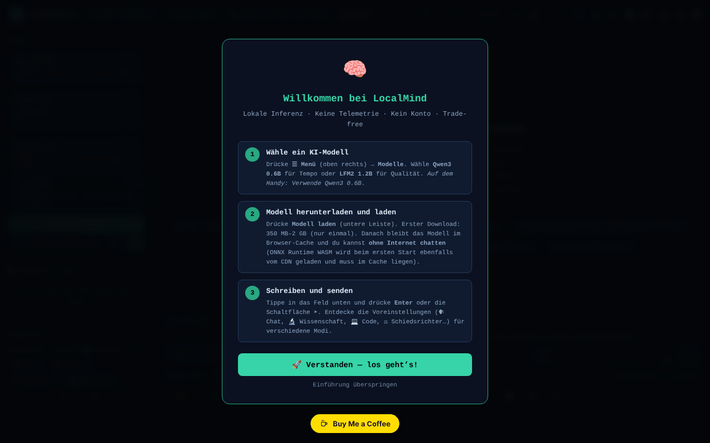

# LocalMind

[English](README.md) · [Română](README.ro.md) · [Français](README.fr.md) · [Italiano](README.it.md) · [Español](README.es.md) · [Português](README.pt.md) · **Deutsch** · [Magyar](README.hu.md)

**Version:** 120.2.0 · **Zuletzt aktualisiert:** 2026-10-19

Oberflächensprachen: **Română, English, Français, Italiano, Español, Português (PT), Deutsch, Magyar**

Ein KI-Assistent, der im Browser läuft (transformers.js + WebGPU), ohne Konto und ohne API-Schlüssel.

**Online-App:** https://chiuta.github.io/LocalMind/

## Was es ist

LocalMind (v120 im Seitentitel) ist eine Chat-Oberfläche für Sprachmodelle, die lokal im Browser laufen, über transformers.js v4.2.0 (WebGPU, mit CPU/WASM-Alternative, wo nötig). Du wählst ein Modell, drückst „Încarcă Modelul“ (Modell laden), und das Modell wird einmalig von Hugging Face heruntergeladen und bleibt im Cache des Browsers. Die Oberfläche ist auf Rumänisch, und die App zeigt die Abzeichen „FĂRĂ TELEMETRIE“ (OHNE TELEMETRIE) und „FĂRĂ CONT“ (OHNE KONTO) an (in früheren Versionen: „ZERO TELEMETRY“ / „NO ACCOUNT“; präziser umformuliert — siehe „Haftungsausschluss“).

## Funktionen

- Voreingestellte Modelle: Qwen3 0.6B, LFM2 1.2B, Qwen3 1.7B, Qwen3 4B (in der Oberfläche angezeigte Größen: ~550 MB, ~700 MB, ~1,3 GB, ~2,5 GB), dazu „Descoperă modele ONNX“ (ONNX-Modelle entdecken; Suche im Hugging-Face-Katalog) und eine kuratierte Sammlung.
- Chat mit Streaming, Konversationsverlauf, Zweige/Snapshots, Zusammenführen zweier Zweige, Vergleich zweier Modelle, Lesezeichen, Suche in der Konversation.
- Voreinstellungen für Stil und System-Prompt (Chat, Wissenschaft, Code, Kreativ, Rumänisch, Mathe, Übersetzung, Zusammenfassung, Sokratisch usw.), Parameter (temperature, Top-P, Wiederholungsstrafe, max tokens), Variablen `{{date}}`, `{{time}}`, `{{model}}`, `{{name}}`.
- Dokumente (RAG): Hochladen von TXT / MD / CSV / PDF (lokales pdf.js).
- Persistenter Speicher, tägliches Token-Budget, Prompt-Bibliothek (JSON-Export/-Import), Timer (Pomodoro, Deep, Sprint), Fokusmodus.
- Visualisierung der Konversation (Mindmap, Diagramm), Export als TXT / MD / JSON / JSONL / PDF / HTML, Export nach Obsidian, Logseq, Notion, anonyme Variante.
- Rendering von Markdown, KaTeX und Mermaid (bei Bedarf geladen), Ausführung von Python-Code über Pyodide (bei Bedarf geladen).
- Spracheingabe und Vorlesen (Browser-APIs, wo vorhanden), Tastatur mit Kürzeln.
- „Audit Rețea“ (Netzwerk-Audit): ein Panel, das die während der Inferenz gestellten Netzwerkanfragen zählt.
- Designs (hell/dunkel, nächtlich), einfacher Modus, Barrierefreiheit (Textgröße, Legasthenie).

## Neue Funktionen (120.1.0)

- **🛡 Geprüft anonym (.txt):** Vor dem Export einer Konversation scannt die App sie lokal (`FFF.pii`) und zeigt dir, was sie gefunden hat; du kannst die angekreuzten Elemente maskieren oder unverändert exportieren. Findet sie nichts, sagt sie ausdrücklich, dass die Erkennung heuristisch ist und etwas übersehen kann.
- **🔎 Alles durchsuchen:** lokale Suche (BM25, diakritische Zeichen, ähnliche Formen; `FFF.search`) in allen auf diesem Gerät gespeicherten Konversationen, mit hervorgehobenen Ausschnitten, Öffnen einer Konversation und deren Löschen. Es wird nichts gesendet.
- **🔐 Verschlüsselte Kopie:** öffnet das Transparenzlabel für den `.fff.json`-Export/-Import mit Passwort (AES-GCM, PBKDF2) und das Löschen der App-Daten.
- **Anzeige „🔒 Nichts verlässt das Gerät“:** stützt sich auf das Netzwerkprotokoll der App (das vorhandene Audit) und wird zu „⚠ N Anfragen an andere Hosts“, wenn eine Anfrage außerhalb von `huggingface.co` / `cdn.jsdelivr.net` auftaucht. Grenze: Sie sieht nur die über das `fetch` der Seite gestellten Anfragen, nicht den gesamten Verkehr des Browsers; prüfe auch im Netzwerk-Tab.
- **🧪 Qualitätsbewertung (ehrlich):** führt das **tatsächlich geladene Modell** an 8 kleinen Aufgaben mit automatisch überprüfbarer Antwort aus (Arithmetik, gültiges JSON, genau drei Wörter, Extraktion, Sprache, exaktes Kopieren, Deduktion, Enthaltung), mit deterministischer Dekodierung. Sie zeigt den Score mit einem **95-%-Wilson-Intervall**, die Zeit bis zum ersten Token und die Geschwindigkeit (auf deinem Gerät gemessene Mediane), Details pro Aufgabe, JSON-Export. Überlappen sich die Intervalle zweier Modelle, sagt die App, dass sich nicht entscheiden lässt, welches besser ist. Sie simuliert nichts: Ohne geladenes Modell ist die Schaltfläche deaktiviert.

### Grenzen
- 8 Aufgaben sind ein grobes Signal, keine allgemeine Rangliste der Modelle; die Aufgaben sind auf Rumänisch, und kleine Modelle können am Format scheitern, nicht am „Verstehen“.
- Die Geschwindigkeit hängt vom Gerät, von WebGPU/WASM, von der Temperatur und von anderen geöffneten Tabs ab.
- Die Erkennung personenbezogener Daten ist heuristisch.

**FFF-Kit.** Aus dem `fff-kit` (in `index.html` eingefügt, ohne Netzwerk) werden die Module `core, label, bundle, pii, search` verwendet: Transparenzlabel (Version in der Fußzeile drücken), `.fff.json`-Export/-Import/-Löschung mit optionaler AES-GCM- + PBKDF2-Verschlüsselung, lokale Erkennung personenbezogener Daten und lokale BM25-Suche. Die CSP-Richtlinie wurde gegenüber der vorherigen Version **nicht geändert**, abgesehen von den `sha256`-Hashes der Inline-Skripte (die neuen Stile stehen in `<style>`, abgedeckt durch das bereits vorhandene `style-src 'unsafe-inline'`; es wurde kein neuer Host hinzugefügt). Die Übersetzungen der neuen Texte in fr/it/es/pt/hu/de sind automatisch erstellt und **nicht von Muttersprachlern geprüft**. Die Erkennung personenbezogener Daten ist heuristisch: Sie kann etwas übersehen oder fälschlich melden; sie ersetzt nicht deine eigene Prüfung.

## Anleitung

1. Öffne die Seite in einem Browser mit WebGPU (die App erkennt das Gerät in der Kopfzeile).
2. Wähle ein Modell aus der Liste „Model“ (zum Beispiel Qwen3 0.6B für einen schnellen Start) und drücke „⬇ Încarcă Modelul“. Beim ersten Laden wird das Modell von huggingface.co heruntergeladen.
3. Schreibe in das Nachrichtenfeld und sende mit `Enter` (`Shift+Enter` für einen Zeilenumbruch). `Escape` stoppt die Generierung.
4. Passe die Stilvoreinstellung, den System-Prompt und die Parameter im Seitenpanel an.
5. Ziehe für Dokumente eine Datei in den Bereich „Documente (RAG)“ oder klicke darauf; aktiviere „RAG activ“.
6. Speichere und exportiere die Konversation über die Export-Schaltflächen (oder `Strg+Umschalt+S`, `Strg+Umschalt+X`, `Strg+Umschalt+J`).
7. Nützliche Kürzel: `?` Kürzelfenster, `Alt+M` Menü, `Alt+S` einfacher Modus, `Alt+N` Nachtmodus, `Alt+L` helles Design, `Alt+V` Spracheingabe, `Alt+C` neue Konversation, `Alt+H` Verlauf, `Alt+D` Statistiken, `Strg+F` Suche, `Strg+B` Sprung zum Lesezeichen, `Alt+1–5` schneller Modellwechsel.
8. Öffne „Audit Rețea“, um die Netzwerkanfragen während der Generierung zu sehen.

## Datenschutz und Netzwerk

- **Lokaler Speicher:** `localStorage` (Schlüssel mit dem Präfix `lm_`: Einstellungen, gespeicherte Konversationen, Prompt-Bibliothek, Speicher, Budget, Benchmarks usw.) und Cache Storage (von transformers.js heruntergeladene Modelle und ein kleiner Service Worker für CDN-Ressourcen). Der Text der Konversationen wird von der App nirgendwohin gesendet.
- **Netzwerk (Drittanbieter-Hosts):**
  - `huggingface.co` (und `*.huggingface.co`, `hf.co`): Herunterladen der ONNX-Modelle und Suche im Katalog, nur wenn du ein Modell lädst oder nach Modellen suchst.
  - `cdn.jsdelivr.net`: KaTeX, Mermaid 11.15.0 und Pyodide 0.27.0, nur bei Bedarf geladen (Formeln, Diagramme, Ausführung von Python-Code). Die CSP der Seite erlaubt nur diese Hosts.
  - transformers.js und pdf.js sind lokal im Ordner `vendor/` des Repositorys enthalten.
- Die App erklärt „null Netzwerkanfragen bei der Inferenz“: Nach dem Laden des Modells läuft die Generierung lokal.

## Haftungsausschluss

Die Antworten kleiner Modelle können falsch, unvollständig oder erfunden sein („Halluzinationen“); überprüfe sie. Die App bietet keine medizinische, rechtliche oder finanzielle Beratung. Die Abzeichen „FĂRĂ TELEMETRIE“ / „FĂRĂ CONT“ (der Tooltip des Abzeichens sagt dasselbe) beziehen sich darauf, dass die App weder Konversationen noch Nutzungsdaten an einen Server des Autors sendet; die Seite kontaktiert jedoch huggingface.co (Modell-Download, Suche) und cdn.jsdelivr.net (KaTeX, Mermaid, Pyodide), wie oben beschrieben.

## Komponenten von Drittanbietern

Der Ordner `vendor/` enthält Kopien von Bibliotheken mit eigenen, von MIT abweichenden Lizenzen: pdf.js (Mozilla, Apache-2.0 — der Hinweis steht im Dateiheader), transformers.js 4.2.0 (Hugging Face, Apache-2.0 laut Upstream-Projekt; die minifizierte Datei enthält den Hinweis nicht) und `qrcode.min.js` (qrcodejs, MIT laut Upstream-Projekt; zur Erzeugung von QR-Codes verwendet). Die MIT-Lizenz gilt für den Code des Autors, nicht für die Komponenten von Drittanbietern. Die von Hugging Face heruntergeladenen Modelle haben ihre eigenen Lizenzen (z. B. Qwen3 unter Apache-2.0, LFM2 unter der Liquid-AI-Lizenz).

## Lokal / offline ausführen

Lade das gesamte Verzeichnis herunter (nicht nur `index.html`, da die Skripte von transformers.js und pdf.js in `vendor/` liegen) und stelle es mit einem lokalen Webserver bereit (z. B. `python3 -m http.server 8080`, dann `http://localhost:8080/`). **Direktes Öffnen von `index.html` aus dem Dateisystem (`file://`):** Die Oberfläche startet jetzt normal, aber das Laden der Modelle wird vom Browser blockiert (ES-Module aus `vendor/`, CORS-Richtlinie); die App zeigt eine klare Meldung mit den Schritten für den lokalen Server, statt einer toten Oberfläche (geprüft am 2026-10-11). Firefox und Safari können ähnliche Einschränkungen haben. Beim ersten Gebrauch jedes Modells ist Internet nötig; danach liegt das Modell im Cache. KaTeX, Mermaid und Pyodide benötigen beim ersten Gebrauch Internet.

Siehe auch: [VENDOR-README.md](VENDOR-README.md) — Hinweise zum Vendoring (was lokal enthalten ist, wie man vollständig offline arbeitet; auf Rumänisch).

## Lizenz

MIT — siehe die Datei LICENSE. Der Header von `index.html` nannte früher auch „TRADE-FREE LICENSE v1.0“ (unter der Bedingung, dass Ableitungen trade-free bleiben); das wurde vereinheitlicht (derzeit MIT), und der Trade-free-Geist bleibt eine Einladung, keine rechtliche Bedingung. Die Komponenten in `vendor/` bleiben unter ihren eigenen Lizenzen (siehe „Komponenten von Drittanbietern“).

## Audit

2026-10-11 (Runde 2): Lizenz im Header vereinheitlicht (derzeit MIT); Abzeichen umformuliert; helles Design repariert (Variablen `--sf`, `--sf2`, `--tx3` für `body.light-mode` definiert: die Vorschlagsschaltflächen, `kbd` und die übrigen Flächen bleiben nicht mehr dunkel); das Panel „Erweiterte Parameter“ (CSS in einem ungenutzten Block geblieben) wird jetzt korrekt ausgeblendet, mit wahrem `aria-hidden`.

2026-10-10: im Browser geprüft (0 JS-Fehler beim Laden; beim Laden gehen keine Netzwerkanfragen hinaus) sowie die CSP der Seite. Zugängliche Namen, ein Hinweis zur Zuverlässigkeit der Modelle und die obigen Lizenzhinweise hinzugefügt.

## Verlauf / Changelog

### 120.1.1 — 2026-10-18
- Die Suche in den angehängten Dokumenten (RAG) normalisiert den Text NFD→NFC und ignoriert diakritische Zeichen (ș/ş/s, ă/a; NFD-Text von macOS), und Wörter mit 3 Buchstaben (IMI, RAG) zählen jetzt (Schwelle ≥3 statt >3; „UE“ mit 2 Buchstaben bleibt unter der Schwelle).

### 120.1.0 — 2026-10-14
- Geprüfter anonymer Export (`FFF.pii`), Suche in allen Konversationen (`FFF.search`), verschlüsselte Kopie (`FFF.bundle`), Anzeige „nichts verlässt das Gerät“, Qualitätsbewertung des lokalen Modells mit Konfidenzintervallen; Tests in `tests/fff-r8.test.mjs`. Hauptnummerierung v120 beibehalten.

### 120.0.1 — 2026-10-12
- Die Version und das Datum der letzten Aktualisierung werden in der App angezeigt (Fußzeile der Seitenleiste); Version 120.0.1 in Titel, Exporten und Header (Hauptnummerierung v120 beibehalten).

### v120 — 11. Oktober 2026 (Runde 7)
- Behoben: Die Schaltfläche der Stilvoreinstellungen (Chat, Wissenschaft, Code …) änderte den System-Prompt, hob aber die aktive Voreinstellung nicht mehr hervor (der Selektor suchte das Attribut `onclick`, das beim Wechsel zum delegierten Dispatcher entfernt wurde); sie verwendet jetzt `data-prompt`. Im Browser reproduziert und geprüft.
- Version v120 (Titel, Exporte, Header); CSP-Hash des Skripts neu berechnet. `'unsafe-eval'` bleibt (Ausführung von JS-Code und ONNX/WASM).

### v119 — 11. Oktober 2026 (Runde 6)
- Sicherheit: Alle ~300 Inline-Handler (`onclick=`, `oninput=` usw.; 242 verschiedene) wurden durch einen einzigen delegierten Dispatcher ersetzt (`data-on-*` + ein separates klassisches Skript, ohne `eval`/`Function`; bei dynamisch erzeugtem Markup laufen die Argumente über JSON-`data-args`, und nur eine feste Liste von Funktionen kann aufgerufen werden). Die CSP hat jetzt `script-src` per SHA-256-Hash (zwei Skripte), ohne `'unsafe-inline'`; `'unsafe-eval'` bleibt für die Funktion „Ausführen“ der JavaScript-Codeblöcke nötig und `'wasm-unsafe-eval'` für ONNX Runtime.
- Verhaltensparität geprüft: An allen 253 Elementen mit Handlern (242 verschiedene Handler) wurden die ursprünglichen Ereignisse ausgelöst und die Aufrufe, Stiländerungen, das DOM und `defaultPrevented` vorher und nachher verglichen: 0 Unterschiede.
- Behoben: Acht von Handlern verwendete Funktionen (`_highlightSearch`, `_seekTimelineDebounced`, `_checkPromptLength`, `_updateGhostText`, `_trackWPM`, `_checkExpander`, `_updateTypingTokens`, `_runGlobSearch`) waren nur im Modul definiert, sodass die Inline-Handler `ReferenceError` auslösten (die Suche mit Hervorhebung, der Positionsregler in der Konversation, die globale Suche und die Prüfungen beim Tippen liefen nicht); sie sind jetzt auf `window` verfügbar.

### v118 — 11. Oktober 2026
- Behoben: Auf `file://` ist die Oberfläche nicht mehr tot (ReferenceError doLoad/setTemp/useChip): transformers.js wird bei Bedarf geladen (dynamischer Import), und „Încarcă Modelul“ zeigt eine erklärende Meldung an.
- Behoben: Der CSS- und HTML-Block für ~24 Panels (Konversationsverlauf, QR, Statistiken, Analysen, Lernkarten, Benchmark, globale Suche, Karte usw.), der versehentlich in die Vorlage `exportAsHTML()` eingefügt worden war, steht jetzt in `<head>`/`<body>`; ihre Funktionen sind nicht mehr tot, und das Titelfeld der Konversation erscheint nicht mehr als weißes Rechteck.
- Behoben: Auf dem Smartphone wird der Chatbereich nicht mehr von der Statusleiste verdeckt (kompakte Leiste in 3 Zeilen, der Willkommensbildschirm scrollt, statt das Nachrichtenfeld zu verdrängen); das Banner „Installieren“ und die Wiedergabeleiste werden nicht mehr dauerhaft angezeigt.
- Behoben: eine beschädigte CSS-Regel, `<h1>` für den App-Titel, `<header>`/`<footer>` und eine Beschriftung für das Feld der Modell-ID; 0 axe-core-Verstöße bei 1280 und 360 px.
- Unverändert: Die Inline-`onclick`-Handler (≈300) und `eval`/`new Function` aus der Ausführung von Codeblöcken bleiben (die CSP erlaubt `'unsafe-inline'`); ihre Entfernung erfordert eine umfassendere Umstrukturierung.

## Autor

Alexio — Alexandru-Ionuț Chiuță, Kontakt: alexio@trom.tf

## Zusammenfassung

LocalMind ist eine browserbasierte Chat-Oberfläche für kleine Sprachmodelle (Qwen3, LFM2), die über transformers.js und WebGPU laufen, mit RAG über lokale Dokumente, Gesprächsverzweigung, Exporten und einem Netzwerk-Audit-Panel. Die Modelle werden einmalig von huggingface.co heruntergeladen; KaTeX, Mermaid und Pyodide werden bei Bedarf von cdn.jsdelivr.net geladen; transformers.js und pdf.js sind lokal eingebunden. Einstellungen und Chats liegen in localStorage (`lm_`-Schlüssel). Die Oberfläche ist auf Rumänisch.
