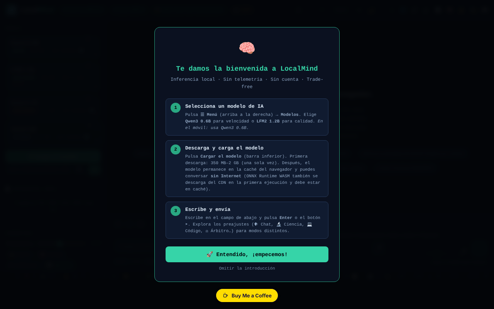

# LocalMind

[English](README.md) · [Română](README.ro.md) · [Français](README.fr.md) · [Italiano](README.it.md) · **Español** · [Português](README.pt.md) · [Deutsch](README.de.md) · [Magyar](README.hu.md)

**Versión:** 120.2.11 · **Última actualización:** 2026-10-23

Idiomas de la interfaz: **Română, English, Français, Italiano, Español, Português (PT), Deutsch, Magyar**

Un asistente de IA que se ejecuta en el navegador (transformers.js + WebGPU), sin cuenta y sin clave de API.

**Aplicación en línea:** https://chiuta.github.io/LocalMind/

## Qué es

LocalMind (v120 en el título de la página) es una interfaz de chat con modelos de lenguaje que se ejecutan localmente en el navegador, mediante transformers.js v4.2.0 (WebGPU, con alternativa CPU/WASM donde corresponda). Eliges un modelo, pulsas «Încarcă Modelul» (Cargar el modelo), y el modelo se descarga una sola vez desde Hugging Face y permanece en la caché del navegador. La interfaz está en rumano, y la aplicación muestra las insignias «FĂRĂ TELEMETRIE» (SIN TELEMETRÍA) y «FĂRĂ CONT» (SIN CUENTA) (en versiones anteriores: «ZERO TELEMETRY» / «NO ACCOUNT»; reformuladas para ser precisas — véase «Advertencia»).

## Funciones

- Modelos predefinidos: Qwen3 0.6B, LFM2 1.2B, Qwen3 1.7B, Qwen3 4B (tamaños mostrados en la interfaz: ~550 MB, ~700 MB, ~1,3 GB, ~2,5 GB), además de «Descoperă modele ONNX» (Descubrir modelos ONNX; búsqueda en el catálogo de Hugging Face) y una colección seleccionada.
- Chat con streaming, historial de conversaciones, ramas/instantáneas, fusión de dos ramas, comparación de dos modelos, marcadores, búsqueda en la conversación.
- Preajustes de estilo y de system prompt (Chat, Ciencia, Código, Creativo, Rumano, Matemáticas, Traducción, Resumen, Socrático, etc.), parámetros (temperature, Top-P, penalización de repetición, max tokens), variables `{{date}}`, `{{time}}`, `{{model}}`, `{{name}}`.
- Documentos (RAG): carga de TXT / MD / CSV / PDF (pdf.js local).
- Memoria persistente, presupuesto diario de tokens, biblioteca de prompts (exportación/importación JSON), temporizadores (Pomodoro, Deep, Sprint), modo foco.
- Visualización de la conversación (mapa mental, diagrama), exportación a TXT / MD / JSON / JSONL / PDF / HTML, exportación a Obsidian, Logseq, Notion, variante anónima.
- Renderizado de Markdown, KaTeX y Mermaid (cargados bajo demanda), ejecución de código Python mediante Pyodide (cargado bajo demanda).
- Dictado por voz y lectura en voz alta (API del navegador, donde existan), teclado con atajos.
- «Audit Rețea» (Auditoría de red): un panel que cuenta las solicitudes de red realizadas durante la inferencia.
- Temas (claro/oscuro, nocturno), modo Simple, accesibilidad (tamaño del texto, dislexia).

## Novedades (120.1.0)

- **🛡 Anónimo verificado (.txt):** antes de exportar una conversación, la aplicación la analiza localmente (`FFF.pii`) y te muestra lo que ha encontrado; puedes enmascarar los elementos marcados o exportar sin cambios. Si no encuentra nada, indica explícitamente que la detección es heurística y puede pasar algo por alto.
- **🔎 Buscar en todo:** búsqueda local (BM25, signos diacríticos, formas cercanas; `FFF.search`) en todas las conversaciones guardadas en este dispositivo, con fragmentos resaltados, apertura de una conversación y su eliminación. No se envía nada.
- **🔐 Copia cifrada:** abre la etiqueta de transparencia para la exportación/importación `.fff.json` con contraseña (AES-GCM, PBKDF2) y el borrado de los datos de la aplicación.
- **Indicador «🔒 Nada sale del dispositivo»:** se basa en el registro de red de la aplicación (la auditoría existente) y pasa a «⚠ N solicitudes a otros hosts» si aparece alguna solicitud fuera de `huggingface.co` / `cdn.jsdelivr.net`. Límite: solo ve las solicitudes hechas mediante el `fetch` de la página, no todo el tráfico del navegador; comprueba también en la pestaña Red.
- **🧪 Evaluación de la calidad (honesta):** ejecuta el **modelo real cargado** en 8 pequeñas tareas con respuesta verificable automáticamente (aritmética, JSON válido, exactamente tres palabras, extracción, idioma, copia exacta, deducción, abstención), con decodificación determinista. Muestra la puntuación con un **intervalo de Wilson del 95 %**, el tiempo hasta el primer token y la velocidad (medianas medidas en tu dispositivo), el detalle por tarea y la exportación JSON. Cuando los intervalos de dos modelos se solapan, la aplicación dice que no se puede decidir cuál es mejor. No simula nada: sin un modelo cargado, el botón está desactivado.

### Límites
- 8 tareas son una señal burda, no una clasificación general de modelos; las tareas están en rumano, y los modelos pequeños pueden fallar por el formato, no por la «comprensión».
- La velocidad depende del dispositivo, de WebGPU/WASM, de la temperatura y de otras pestañas abiertas.
- La detección de datos personales es heurística.

**Kit FFF.** Del `fff-kit` (integrado en `index.html`, sin red) se usan los módulos `core, label, bundle, pii, search`: etiqueta de transparencia (pulsa la versión en el pie de página), exportación/importación/borrado `.fff.json` con cifrado opcional AES-GCM + PBKDF2, detección local de datos personales y búsqueda local BM25. La política CSP **no se ha modificado** respecto a la versión anterior, salvo los hashes `sha256` de los scripts en línea (los estilos nuevos están en `<style>`, cubierto por el `style-src 'unsafe-inline'` ya presente; no se añadió ningún host nuevo). Las traducciones de los textos nuevos a fr/it/es/pt/hu/de son automáticas y **no están verificadas por hablantes nativos**. La detección de datos personales es heurística: puede pasar por alto o señalar por error; no sustituye tu propia comprobación.

## Guía de uso

1. Abre la página en un navegador con WebGPU (la aplicación detecta el dispositivo en la cabecera).
2. Elige un modelo de la lista «Model» (por ejemplo Qwen3 0.6B para un arranque rápido) y pulsa «⬇ Încarcă Modelul». La primera carga descarga el modelo de huggingface.co.
3. Escribe en el campo de mensaje y envía con `Intro` (`Mayús+Intro` para un salto de línea). `Escape` detiene la generación.
4. Ajusta el preajuste de estilo, el system prompt y los parámetros en el panel lateral.
5. Para los documentos, arrastra un archivo a la zona «Documente (RAG)» o haz clic en ella; activa «RAG activ».
6. Guarda y exporta la conversación con los botones de exportación (o `Ctrl+Mayús+S`, `Ctrl+Mayús+X`, `Ctrl+Mayús+J`).
7. Atajos útiles: `?` ventana de atajos, `Alt+M` menú, `Alt+S` modo Simple, `Alt+N` modo nocturno, `Alt+L` tema claro, `Alt+V` dictado, `Alt+C` conversación nueva, `Alt+H` historial, `Alt+D` estadísticas, `Ctrl+F` buscar, `Ctrl+B` salto al marcador, `Alt+1–5` cambio rápido de modelo.
8. Abre «Audit Rețea» para ver las solicitudes de red durante la generación.

## Privacidad y red

- **Almacenamiento local:** `localStorage` (claves con el prefijo `lm_`: preferencias, conversaciones guardadas, biblioteca de prompts, memoria, presupuesto, benchmarks, etc.) y Cache Storage (modelos descargados por transformers.js y los binarios de Pyodide/ONNX Runtime verificados y un pequeño service worker para los archivos de la aplicación). La aplicación no envía a ninguna parte el texto de las conversaciones.
- **Red (hosts de terceros):**
  - `huggingface.co` (y `*.huggingface.co`, `hf.co`): descarga de modelos ONNX y búsqueda en el catálogo, solo cuando cargas un modelo o buscas modelos.
  - `cdn.jsdelivr.net`: solo los binarios de Pyodide 0.27.0 (`.wasm`, `python_stdlib.zip`, archivo lock; los dos scripts se cargan con SRI) y el `.wasm` de ONNX Runtime Web (versión npm fijada), cargados solo cuando hacen falta (ejecución de código Python, carga de un modelo). Cada archivo se verifica con SHA-256 antes de usarse y se rechaza si no coincide; la CSP de la página permite exactamente estas URL.
  - transformers.js, pdf.js, KaTeX 0.16.9, Mermaid 11.15.0, qrcode.js y los cargadores de ONNX Runtime Web están incluidos localmente en la carpeta `vendor/` del repositorio (cargados desde el mismo origen; KaTeX y Mermaid con SRI).
- La aplicación afirma «cero solicitudes de red durante la inferencia»: una vez cargado el modelo, la generación se ejecuta localmente.

## Advertencia

Las respuestas de los modelos pequeños pueden ser erróneas, incompletas o inventadas («alucinaciones»); verifícalas. La aplicación no ofrece consejos médicos, jurídicos ni financieros. Las insignias «FĂRĂ TELEMETRIE» / «FĂRĂ CONT» (la información emergente de la insignia dice lo mismo) se refieren a que la aplicación no envía las conversaciones ni datos de uso a un servidor del autor; la página sí contacta con huggingface.co (descarga de modelos, búsqueda) y cdn.jsdelivr.net (Pyodide, ONNX Runtime), como se describe más arriba.

## Componentes de terceros

La carpeta `vendor/` contiene copias de bibliotecas con licencias propias, distintas de MIT: pdf.js (Mozilla, Apache-2.0 — el aviso está en la cabecera del archivo), transformers.js 4.2.0 (Hugging Face, Apache-2.0 según el proyecto original; el archivo minificado no contiene el aviso) y `qrcode.min.js` (qrcodejs, MIT según el proyecto original; usado para generar códigos QR). La licencia MIT se aplica al código del autor, no a los componentes de terceros. Los modelos descargados de Hugging Face tienen sus propias licencias (p. ej., Qwen3 bajo Apache-2.0, LFM2 bajo la licencia de Liquid AI). También en `vendor/` (véase `NOTICE.md`): KaTeX 0.16.9 (MIT), Mermaid 11.15.0 (MIT) y los cargadores de ONNX Runtime Web (MIT). Pyodide 0.27.0 (MPL-2.0) y los archivos `.wasm` de ONNX Runtime no están en el repositorio: se descargan de URL fijadas y se verifican con SHA-256.

## Ejecución local / sin conexión

Descarga el directorio completo (no solo `index.html`, porque los scripts de transformers.js y pdf.js están en `vendor/`) y sírvelo con un servidor web local (p. ej. `python3 -m http.server 8080`, y luego `http://localhost:8080/`). **Apertura directa de `index.html` desde el sistema de archivos (`file://`):** la interfaz arranca ahora con normalidad, pero la carga de modelos queda bloqueada por el navegador (módulos ES de `vendor/`, política CORS); la aplicación muestra un mensaje claro con los pasos para el servidor local, en lugar de una interfaz inerte (verificado el 2026-10-11). Firefox y Safari pueden tener restricciones similares. Hace falta internet la primera vez que se usa cada modelo; después el modelo está en la caché. KaTeX, Mermaid y Pyodide necesitan internet en el primer uso.

Véase también: [VENDOR-README.md](VENDOR-README.md) — Notas sobre el vendoring (qué se incluye localmente, cómo funcionar 100 % sin conexión; en rumano).

## Licencia

MIT — véase el archivo LICENSE. La cabecera de `index.html` decía antes también «TRADE-FREE LICENSE v1.0» (con la condición de que las obras derivadas siguieran siendo trade-free); se ha unificado (actualmente MIT), y el espíritu trade-free sigue siendo una invitación, no una condición legal. Los componentes de `vendor/` siguen bajo sus propias licencias (véase «Componentes de terceros»).

## Auditoría

2026-10-11 (ronda 2): licencia unificada en la cabecera (actualmente MIT); insignias reformuladas; tema claro reparado (variables `--sf`, `--sf2`, `--tx3` definidas para `body.light-mode`: los botones de sugerencia, `kbd` y las demás superficies ya no permanecen oscuros); el panel «Parámetros avanzados» (CSS que quedó en un bloque sin usar) ahora se oculta correctamente, con `aria-hidden` verdadero.

2026-10-10: verificado en el navegador (0 errores de JS al cargar; al cargar no sale ninguna solicitud de red) y la CSP de la página. Añadidos nombres accesibles, una nota sobre la fiabilidad de los modelos y las notas sobre licencias anteriores.

## Historial / Changelog

### 120.2.10 — 2026-10-22
Diseño: la barra superior ya no se desborda entre 769 y 1500 px (el último botón quedaba cortado a 1366 px); campos de texto de al menos 24 px de alto; botones de lectura, estrella, voz y respuestas rápidas de 44 px con puntero grueso. Nueva auditoría a 360 y 1366 px: ningún objetivo por debajo de 24 px ni texto por debajo de 12 px.

### 120.2.9 — 2026-10-22
- Seguridad: ya no se carga ningún código de un CDN en tiempo de ejecución. KaTeX 0.16.9 (JS, CSS, fuentes woff2) y Mermaid 11.15.0 pasan a `vendor/` (mismo origen, SRI), igual que los cargadores de ONNX Runtime Web. El `.wasm` de ONNX Runtime (23,5 MB, o 12,9 MB en Safari) y Pyodide 0.27.0 (`.wasm` 10,1 MB, stdlib, lock) quedan fuera del repositorio: se descargan de URL inmutables fijadas y se verifican con SHA-256 antes de usarse (si no, se rechazan; luego se guardan en Cache Storage y se reverifican en cada lectura); `pyodide.js` y `pyodide.asm.js` se cargan con SRI.
- CSP: `cdn.jsdelivr.net` fuera de `style-src`/`font-src`; `script-src` y `connect-src` solo listan los archivos exactos. Unos 4 MB añadidos al repositorio (véase `NOTICE.md`). Los modelos de Hugging Face siguen sin fijar (datos, no código).

### 120.2.8 — 2026-10-22

fff-kit 1.1.4: áreas táctiles y texto mínimo. Áreas táctiles/texto corregidos en la aplicación.

### 120.2.7 — 2026-10-22
- Seguridad: la búsqueda global y la búsqueda en la conversación ya no insertan la consulta escrita ni el texto de los mensajes como HTML (DOM-XSS latente); los resultados se construyen con nodos de texto.

### 120.2.6 — 2026-10-22

fff-kit 1.1.2: PBKDF2 con 600.000 iteraciones, protección anti-clickjacking.

### 120.2.5 — 2026-10-22
- Los diálogos nativos (confirm/prompt/alert) se sustituyen por diálogos integrados y traducidos; móvil: barra superior desplazable (todos los botones accesibles), zonas táctiles ≥ 24 px, texto ≥ 12 px, la introducción ya no queda tapada por el botón de donación; `sw.js` real + manifiesto + iconos (carcasa sin conexión tras la primera visita) en lugar del service worker blob: no válido; en Chrome Android, opción experimental «Probar de todos modos con Qwen2.5 0.5B (~300MB)» en lugar de un bloqueo total.

### 120.2.4 — 2026-10-22
- La insignia «nada sale del dispositivo» (texto y tooltip) y el botón «Copia cifrada» ahora se retraducen al instante al cambiar de idioma, sin recargar. El prompt del sistema y los chips de ejemplo se mantienen a propósito en rumano.

### 120.2.3 — 2026-10-22
- el panel de atajos de teclado (título, aria-label y todas las filas) y la etiqueta de la barra lateral están totalmente localizados en los 8 idiomas; el prompt de sistema predeterminado permanece en rumano, a propósito.

### 120.1.1 — 2026-10-18
- La búsqueda en los documentos adjuntos (RAG) normaliza el texto NFD→NFC e ignora los signos diacríticos (ș/ş/s, ă/a; texto NFD de macOS), y las palabras de 3 letras (IMI, RAG) ahora cuentan (umbral ≥3 en lugar de >3; «UE», de 2 letras, queda por debajo del umbral).

### 120.1.0 — 2026-10-14
- Exportación anónima verificada (`FFF.pii`), búsqueda en todas las conversaciones (`FFF.search`), copia cifrada (`FFF.bundle`), indicador «nada sale», evaluación de la calidad del modelo local con intervalos de confianza; pruebas en `tests/fff-r8.test.mjs`. Numeración mayor v120 conservada.

### 120.0.1 — 2026-10-12
- La versión y la fecha de la última actualización se muestran en la aplicación (pie de la barra lateral); versión 120.0.1 en el título, las exportaciones y la cabecera (numeración mayor v120 conservada).

### v120 — 11 de octubre de 2026 (ronda 7)
- Corregido: el botón de los preajustes de estilo (Chat, Ciencia, Código…) cambiaba el prompt de sistema, pero ya no resaltaba el preajuste activo (el selector buscaba el atributo `onclick`, eliminado al pasar al despachador delegado); ahora usa `data-prompt`. Reproducido y verificado en el navegador.
- Versión v120 (título, exportaciones, cabecera); hash CSP del script recalculado. `'unsafe-eval'` se mantiene (ejecución de código JS y ONNX/WASM).

### v119 — 11 de octubre de 2026 (ronda 6)
- Seguridad: los ~300 manejadores en línea (`onclick=`, `oninput=`, etc.; 242 distintos) se sustituyeron por un único despachador delegado (`data-on-*` + un script clásico independiente, sin `eval`/`Function`; para el marcado generado dinámicamente, los argumentos pasan por `data-args` JSON y solo se puede llamar a una lista fija de funciones). La CSP tiene ahora `script-src` por hash SHA-256 (dos scripts), sin `'unsafe-inline'`; `'unsafe-eval'` sigue siendo necesario para la función «Ejecutar» de los bloques de código JavaScript y `'wasm-unsafe-eval'` para ONNX Runtime.
- Verificada la paridad de comportamiento: en los 253 elementos con manejadores (242 manejadores distintos) se dispararon los eventos originales y se compararon las llamadas, los cambios de estilo, el DOM y `defaultPrevented`, antes y después: 0 diferencias.
- Corregido: ocho funciones usadas por los manejadores (`_highlightSearch`, `_seekTimelineDebounced`, `_checkPromptLength`, `_updateGhostText`, `_trackWPM`, `_checkExpander`, `_updateTypingTokens`, `_runGlobSearch`) estaban definidas solo en el módulo, por lo que los manejadores en línea lanzaban `ReferenceError` (la búsqueda con resaltado, el control deslizante de posición en la conversación, la búsqueda global y las comprobaciones al escribir no se ejecutaban); ahora están expuestas en `window`.

### v118 — 11 de octubre de 2026
- Corregido: en `file://` la interfaz ya no está inerte (ReferenceError doLoad/setTemp/useChip): transformers.js se carga bajo demanda (importación dinámica), y «Încarcă Modelul» muestra un mensaje explicativo.
- Corregido: el bloque de CSS y HTML de ~24 paneles (historial de conversaciones, QR, estadísticas, análisis, tarjetas de estudio, benchmark, búsqueda global, mapa, etc.), que se había insertado por error en la plantilla `exportAsHTML()`, está ahora en `<head>`/`<body>`; sus funciones ya no están inertes, y el campo del título de la conversación ya no aparece como un rectángulo blanco.
- Corregido: en móvil, el área de chat ya no queda cubierta por la barra de estado (barra compacta en 3 filas, la pantalla de bienvenida se desplaza en lugar de empujar el campo de mensaje); el banner «Instalar» y la barra de reproducción ya no se muestran de forma permanente.
- Corregido: una regla CSS corrupta, `<h1>` para el título de la aplicación, `<header>`/`<footer>` y una etiqueta para el campo del ID del modelo; 0 violaciones de axe-core a 1280 y 360 px.
- Sin cambios: los manejadores `onclick` en línea (≈300) y `eval`/`new Function` de la ejecución de bloques de código se mantienen (la CSP permite `'unsafe-inline'`); eliminarlos requiere una refactorización más amplia.

## Autor

Alexio — Alexandru-Ionuț Chiuță, contacto: alexio@trom.tf

## Resumen

LocalMind es una interfaz de chat en el navegador para modelos de lenguaje pequeños (Qwen3, LFM2) que se ejecutan mediante transformers.js y WebGPU, con RAG sobre documentos locales, ramificación de conversaciones, exportaciones y un panel de auditoría de red. Los modelos se descargan una sola vez desde huggingface.co; Pyodide y el `.wasm` de ONNX Runtime se cargan bajo demanda desde URL fijadas de cdn.jsdelivr.net y se verifican con SHA-256; transformers.js, pdf.js, KaTeX y Mermaid se incluyen localmente. Los ajustes y los chats se guardan en localStorage (claves `lm_`). La interfaz está en rumano.
