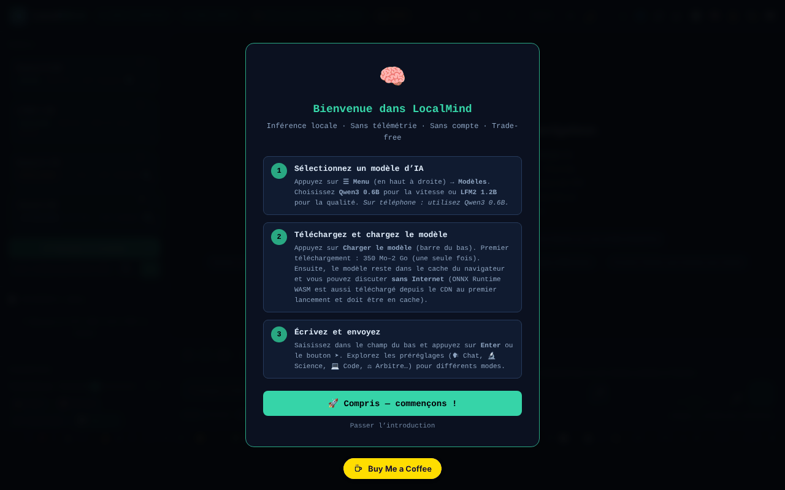

# LocalMind

[English](README.md) · [Română](README.ro.md) · **Français** · [Italiano](README.it.md) · [Español](README.es.md) · [Português](README.pt.md) · [Deutsch](README.de.md) · [Magyar](README.hu.md)

**Version :** 120.2.2 · **Dernière mise à jour :** 2026-10-19

Langues de l'interface : **Română, English, Français, Italiano, Español, Português (PT), Deutsch, Magyar**

Un assistant IA qui s'exécute dans le navigateur (transformers.js + WebGPU), sans compte et sans clé d'API.

**Application en ligne :** https://chiuta.github.io/LocalMind/

## Présentation

LocalMind (v120 dans le titre de la page) est une interface de discussion avec des modèles de langage qui s'exécutent localement dans le navigateur, via transformers.js v4.2.0 (WebGPU, avec une solution de repli CPU/WASM le cas échéant). Vous choisissez un modèle, vous appuyez sur « Încarcă Modelul » (Charger le modèle), et le modèle est téléchargé une seule fois depuis Hugging Face et reste dans le cache du navigateur. L'interface est en roumain, et l'application affiche les badges « FĂRĂ TELEMETRIE » (SANS TÉLÉMÉTRIE) et « FĂRĂ CONT » (SANS COMPTE) (dans les versions précédentes : « ZERO TELEMETRY » / « NO ACCOUNT » ; reformulés pour être précis — voir « Avertissement »).

## Fonctionnalités

- Modèles prédéfinis : Qwen3 0.6B, LFM2 1.2B, Qwen3 1.7B, Qwen3 4B (tailles affichées dans l'interface : ~550 Mo, ~700 Mo, ~1,3 Go, ~2,5 Go), plus « Descoperă modele ONNX » (Découvrir des modèles ONNX ; recherche dans le catalogue Hugging Face) et une collection sélectionnée.
- Discussion en streaming, historique des conversations, branches/instantanés, fusion de deux branches, comparaison de deux modèles, signets, recherche dans la conversation.
- Préréglages de style et de prompt système (Chat, Science, Code, Créatif, Roumain, Maths, Traduction, Résumé, Socratique, etc.), paramètres (temperature, Top-P, pénalité de répétition, max tokens), variables `{{date}}`, `{{time}}`, `{{model}}`, `{{name}}`.
- Documents (RAG) : téléversement de TXT / MD / CSV / PDF (pdf.js local).
- Mémoire persistante, budget quotidien de jetons, bibliothèque de prompts (export/import JSON), minuteurs (Pomodoro, Deep, Sprint), mode focus.
- Visualisation de la conversation (carte mentale, diagramme), export en TXT / MD / JSON / JSONL / PDF / HTML, export vers Obsidian, Logseq, Notion, variante anonyme.
- Rendu Markdown, KaTeX et Mermaid (chargés à la demande), exécution de code Python via Pyodide (chargé à la demande).
- Dictée vocale et lecture à voix haute (API du navigateur, lorsqu'elles existent), clavier avec raccourcis.
- « Audit Rețea » (Audit réseau) : un panneau qui compte les requêtes réseau effectuées pendant l'inférence.
- Thèmes (clair/sombre, nocturne), mode Simple, accessibilité (taille du texte, dyslexie).

## Nouveautés (120.1.0)

- **🛡 Anonyme vérifié (.txt) :** avant d'exporter une conversation, l'application l'analyse localement (`FFF.pii`) et vous montre ce qu'elle a trouvé ; vous pouvez masquer les éléments cochés ou exporter sans modification. Si elle ne trouve rien, elle indique explicitement que la détection est heuristique et peut manquer quelque chose.
- **🔎 Tout rechercher :** recherche locale (BM25, signes diacritiques, formes proches ; `FFF.search`) dans toutes les conversations enregistrées sur cet appareil, avec des extraits surlignés, ouverture d'une conversation et suppression. Rien n'est envoyé.
- **🔐 Copie chiffrée :** ouvre l'étiquette de transparence pour l'export/import `.fff.json` avec mot de passe (AES-GCM, PBKDF2) et l'effacement des données de l'application.
- **Indicateur « 🔒 Rien ne quitte l'appareil » :** il s'appuie sur le journal réseau de l'application (l'audit existant) et devient « ⚠ N requêtes vers d'autres hôtes » si une requête apparaît en dehors de `huggingface.co` / `cdn.jsdelivr.net`. Limite : il ne voit que les requêtes faites par le `fetch` de la page, pas tout le trafic du navigateur ; vérifiez aussi dans l'onglet Réseau.
- **🧪 Évaluation de la qualité (honnête) :** exécute le **modèle réel chargé** sur 8 petites tâches dont la réponse est vérifiable automatiquement (arithmétique, JSON valide, exactement trois mots, extraction, langue, copie exacte, déduction, abstention), avec un décodage déterministe. Elle affiche le score avec un **intervalle de Wilson à 95 %**, le temps jusqu'au premier jeton et la vitesse (médianes mesurées sur votre appareil), le détail par tâche, l'export JSON. Quand les intervalles de deux modèles se chevauchent, l'application dit qu'on ne peut pas décider lequel est meilleur. Elle ne simule rien : sans modèle chargé, le bouton est désactivé.

### Limites
- 8 tâches sont un signal grossier, non un classement général des modèles ; les tâches sont en roumain, et les petits modèles peuvent échouer sur le format, non sur la « compréhension ».
- La vitesse dépend de l'appareil, de WebGPU/WASM, de la température et des autres onglets ouverts.
- La détection des données personnelles est heuristique.

**Kit FFF.** Du `fff-kit` (intégré dans `index.html`, sans réseau), on utilise les modules `core, label, bundle, pii, search` : étiquette de transparence (appuyez sur la version dans le pied de page), export/import/effacement `.fff.json` avec chiffrement facultatif AES-GCM + PBKDF2, détection locale des données personnelles et recherche locale BM25. La politique CSP **n'a pas été modifiée** par rapport à la version précédente, hormis les hachages `sha256` des scripts en ligne (les nouveaux styles sont dans `<style>`, couvert par le `style-src 'unsafe-inline'` déjà présent ; aucun nouvel hôte n'a été ajouté). Les traductions des nouveaux textes en fr/it/es/pt/hu/de sont automatiques et **non vérifiées par des locuteurs natifs**. La détection des données personnelles est heuristique : elle peut manquer ou signaler à tort ; elle ne remplace pas votre propre vérification.

## Mode d'emploi

1. Ouvrez la page dans un navigateur compatible WebGPU (l'application détecte l'appareil dans l'en-tête).
2. Choisissez un modèle dans la liste « Model » (par exemple Qwen3 0.6B pour démarrer rapidement) et appuyez sur « ⬇ Încarcă Modelul ». Le premier chargement télécharge le modèle depuis huggingface.co.
3. Écrivez dans le champ de message et envoyez avec `Entrée` (`Maj+Entrée` pour un saut de ligne). `Échap` arrête la génération.
4. Ajustez le préréglage de style, le prompt système et les paramètres dans le panneau latéral.
5. Pour les documents, glissez un fichier dans la zone « Documente (RAG) » ou cliquez dessus ; activez « RAG activ ».
6. Enregistrez et exportez la conversation avec les boutons d'export (ou `Ctrl+Maj+S`, `Ctrl+Maj+X`, `Ctrl+Maj+J`).
7. Raccourcis utiles : `?` fenêtre des raccourcis, `Alt+M` menu, `Alt+S` mode Simple, `Alt+N` mode nocturne, `Alt+L` thème clair, `Alt+V` dictée, `Alt+C` nouvelle conversation, `Alt+H` historique, `Alt+D` statistiques, `Ctrl+F` recherche, `Ctrl+B` saut vers un signet, `Alt+1–5` changement rapide de modèle.
8. Ouvrez « Audit Rețea » pour voir les requêtes réseau pendant la génération.

## Confidentialité et réseau

- **Stockage local :** `localStorage` (clés avec le préfixe `lm_` : préférences, conversations enregistrées, bibliothèque de prompts, mémoire, budget, benchmarks, etc.) et Cache Storage (modèles téléchargés par transformers.js et un petit service worker pour les ressources CDN). Le texte des conversations n'est envoyé nulle part par l'application.
- **Réseau (hôtes tiers) :**
  - `huggingface.co` (et `*.huggingface.co`, `hf.co`) : téléchargement des modèles ONNX et recherche dans le catalogue, uniquement lorsque vous chargez un modèle ou recherchez des modèles.
  - `cdn.jsdelivr.net` : KaTeX, Mermaid 11.15.0 et Pyodide 0.27.0, chargés uniquement lorsque nécessaire (formules, diagrammes, exécution de code Python). La CSP de la page n'autorise que ces hôtes.
  - transformers.js et pdf.js sont inclus localement dans le dossier `vendor/` du dépôt.
- L'application affirme « zéro requête réseau pendant l'inférence » : une fois le modèle chargé, la génération s'exécute localement.

## Avertissement

Les réponses des petits modèles peuvent être erronées, incomplètes ou inventées (« hallucinations ») ; vérifiez-les. L'application ne fournit pas de conseils médicaux, juridiques ou financiers. Les badges « FĂRĂ TELEMETRIE » / « FĂRĂ CONT » (l'infobulle du badge dit la même chose) signifient que l'application n'envoie ni les conversations ni les données d'utilisation à un serveur de l'auteur ; la page contacte toutefois huggingface.co (téléchargement des modèles, recherche) et cdn.jsdelivr.net (KaTeX, Mermaid, Pyodide), comme décrit ci-dessus.

## Composants tiers

Le dossier `vendor/` contient des copies de bibliothèques avec leurs propres licences, différentes de MIT : pdf.js (Mozilla, Apache-2.0 — l'avis figure dans l'en-tête du fichier), transformers.js 4.2.0 (Hugging Face, Apache-2.0 selon le projet amont ; le fichier minifié ne contient pas l'avis) et `qrcode.min.js` (qrcodejs, MIT selon le projet amont ; utilisé pour générer des codes QR). La licence MIT s'applique au code de l'auteur, non aux composants tiers. Les modèles téléchargés depuis Hugging Face ont leurs propres licences (par ex. Qwen3 sous Apache-2.0, LFM2 sous la licence Liquid AI).

## Exécution en local / hors ligne

Téléchargez le répertoire entier (pas seulement `index.html`, car les scripts transformers.js et pdf.js se trouvent dans `vendor/`) et servez-le avec un serveur web local (par ex. `python3 -m http.server 8080`, puis `http://localhost:8080/`). **Ouverture directe de `index.html` depuis le système de fichiers (`file://`) :** l'interface démarre désormais normalement, mais le chargement des modèles est bloqué par le navigateur (modules ES depuis `vendor/`, politique CORS) ; l'application affiche un message clair avec les étapes pour le serveur local, au lieu d'une interface inerte (vérifié le 2026-10-11). Firefox et Safari peuvent avoir des restrictions similaires. Internet est nécessaire à la première utilisation de chaque modèle ; ensuite le modèle est dans le cache. KaTeX, Mermaid et Pyodide ont besoin d'internet à la première utilisation.

Voir aussi : [VENDOR-README.md](VENDOR-README.md) — Notes sur le vendoring (ce qui est inclus localement, comment passer au 100 % hors ligne ; en roumain).

## Licence

MIT — voir le fichier LICENSE. L'en-tête de `index.html` mentionnait auparavant aussi « TRADE-FREE LICENSE v1.0 » (à condition que les œuvres dérivées restent trade-free) ; cela a été unifié (actuellement MIT), et l'esprit trade-free reste une invitation, non une condition légale. Les composants de `vendor/` demeurent sous leurs propres licences (voir « Composants tiers »).

## Audit

2026-10-11 (tour 2) : licence unifiée dans l'en-tête (actuellement MIT) ; badges reformulés ; thème clair réparé (variables `--sf`, `--sf2`, `--tx3` définies pour `body.light-mode` : les boutons de suggestion, `kbd` et les autres surfaces ne restent plus sombres) ; le panneau « Paramètres avancés » (CSS resté dans un bloc inutilisé) se masque désormais correctement, avec un `aria-hidden` vrai.

2026-10-10 : vérifié dans le navigateur (0 erreur JS au chargement ; aucune requête réseau ne part au chargement) et la CSP de la page. Ajout de noms accessibles, d'une note sur la fiabilité des modèles et des notes ci-dessus sur les licences.

## Historique / Changelog

### 120.1.1 — 2026-10-18
- La recherche dans les documents joints (RAG) normalise le texte NFD→NFC et ignore les signes diacritiques (ș/ş/s, ă/a ; texte NFD de macOS), et les mots de 3 lettres (IMI, RAG) sont désormais pris en compte (seuil ≥3 au lieu de >3 ; « UE », de 2 lettres, reste sous le seuil).

### 120.1.0 — 2026-10-14
- Export anonyme vérifié (`FFF.pii`), recherche dans toutes les conversations (`FFF.search`), copie chiffrée (`FFF.bundle`), indicateur « rien ne part », évaluation de la qualité du modèle local avec intervalles de confiance ; tests dans `tests/fff-r8.test.mjs`. Numérotation majeure v120 conservée.

### 120.0.1 — 2026-10-12
- La version et la date de la dernière mise à jour sont affichées dans l'application (pied de la barre latérale) ; version 120.0.1 dans le titre, les exports et l'en-tête (numérotation majeure v120 conservée).

### v120 — 11 octobre 2026 (tour 7)
- Corrigé : le bouton des préréglages de style (Chat, Science, Code…) changeait le prompt système, mais ne mettait plus en évidence le préréglage actif (le sélecteur cherchait l'attribut `onclick`, supprimé lors du passage au répartiteur délégué) ; il utilise désormais `data-prompt`. Reproduit et vérifié dans le navigateur.
- Version v120 (titre, exports, en-tête) ; hachage CSP du script recalculé. `'unsafe-eval'` demeure (exécution de code JS et ONNX/WASM).

### v119 — 11 octobre 2026 (tour 6)
- Sécurité : la totalité des ~300 gestionnaires en ligne (`onclick=`, `oninput=`, etc. ; 242 distincts) ont été remplacés par un seul répartiteur délégué (`data-on-*` + un script classique séparé, sans `eval`/`Function` ; pour le balisage généré dynamiquement, les arguments passent par `data-args` JSON et seule une liste fixe de fonctions peut être appelée). La CSP comporte désormais `script-src` par hachage SHA-256 (deux scripts), sans `'unsafe-inline'` ; `'unsafe-eval'` reste nécessaire pour la fonction « Exécuter » des blocs de code JavaScript et `'wasm-unsafe-eval'` pour ONNX Runtime.
- Parité de comportement vérifiée : sur les 253 éléments dotés de gestionnaires (242 gestionnaires distincts), les événements d'origine ont été déclenchés et les appels, modifications de style, DOM et `defaultPrevented` ont été comparés, avant et après : 0 différence.
- Corrigé : huit fonctions utilisées par les gestionnaires (`_highlightSearch`, `_seekTimelineDebounced`, `_checkPromptLength`, `_updateGhostText`, `_trackWPM`, `_checkExpander`, `_updateTypingTokens`, `_runGlobSearch`) n'étaient définies que dans le module, de sorte que les gestionnaires en ligne lançaient `ReferenceError` (la recherche avec surlignage, le curseur de position dans la conversation, la recherche globale et les vérifications à la frappe ne s'exécutaient pas) ; elles sont maintenant exposées sur `window`.

### v118 — 11 octobre 2026
- Corrigé : sur `file://`, l'interface n'est plus inerte (ReferenceError doLoad/setTemp/useChip) : transformers.js se charge à la demande (import dynamique), et « Încarcă Modelul » affiche un message explicatif.
- Corrigé : le bloc de CSS et de HTML pour ~24 panneaux (historique des conversations, QR, statistiques, analyses, cartes mémoire, benchmark, recherche globale, carte, etc.), qui avait été inséré par erreur dans le modèle `exportAsHTML()`, se trouve maintenant dans `<head>`/`<body>` ; leurs fonctions ne sont plus inertes, et le champ du titre de la conversation n'apparaît plus comme un rectangle blanc.
- Corrigé : sur mobile, la zone de discussion n'est plus recouverte par la barre d'état (barre compacte sur 3 lignes, l'écran d'accueil défile au lieu de repousser le champ de message) ; la bannière « Installer » et la barre de lecture ne sont plus affichées en permanence.
- Corrigé : une règle CSS corrompue, `<h1>` pour le titre de l'application, `<header>`/`<footer>` et une étiquette pour le champ de l'ID de modèle ; 0 violation axe-core à 1280 et 360 px.
- Inchangé : les gestionnaires `onclick` en ligne (≈300) et `eval`/`new Function` de l'exécution des blocs de code demeurent (la CSP autorise `'unsafe-inline'`) ; leur suppression demande une refonte plus large.

## Auteur

Alexio — Alexandru-Ionuț Chiuță, contact : alexio@trom.tf

## Résumé

LocalMind est une interface de discussion dans le navigateur pour de petits modèles de langage (Qwen3, LFM2) exécutés via transformers.js et WebGPU, avec RAG sur des documents locaux, ramification des conversations, exports et un panneau d'audit réseau. Les modèles sont téléchargés une seule fois depuis huggingface.co ; KaTeX, Mermaid et Pyodide se chargent à la demande depuis cdn.jsdelivr.net ; transformers.js et pdf.js sont embarqués localement. Les réglages et les discussions sont conservés dans localStorage (clés `lm_`). L'interface est en roumain.

