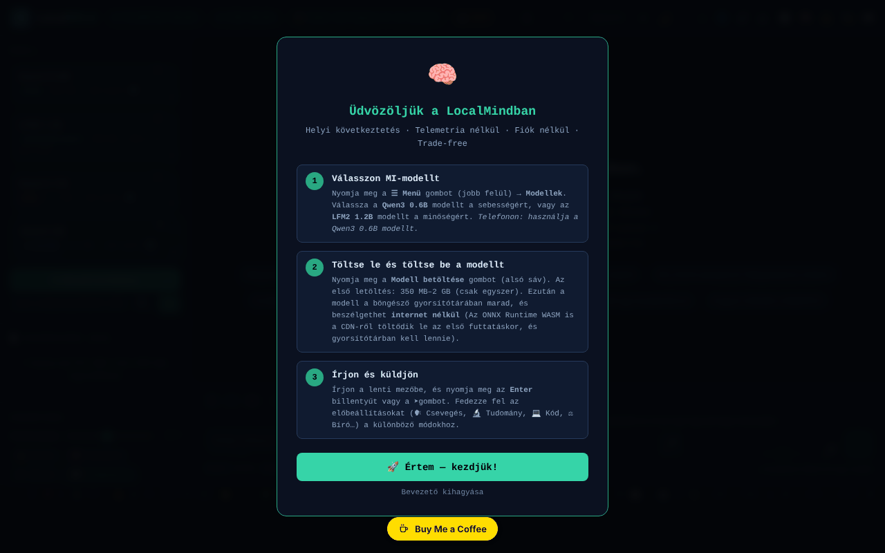

# LocalMind

[English](README.md) · [Română](README.ro.md) · [Français](README.fr.md) · [Italiano](README.it.md) · [Español](README.es.md) · [Português](README.pt.md) · [Deutsch](README.de.md) · **Magyar**

**Verzió:** 120.2.0 · **Utolsó frissítés:** 2026-10-19

A felület nyelvei: **Română, English, Français, Italiano, Español, Português (PT), Deutsch, Magyar**

Böngészőben futó MI-asszisztens (transformers.js + WebGPU), fiók és API-kulcs nélkül.

**Online alkalmazás:** https://chiuta.github.io/LocalMind/

## Mi ez

A LocalMind (az oldal címében v120) egy csevegőfelület helyben, a böngészőben futó nyelvi modellekhez, a transformers.js v4.2.0-n keresztül (WebGPU, szükség esetén CPU/WASM tartalékkal). Kiválasztasz egy modellt, megnyomod az „Încarcă Modelul” (Modell betöltése) gombot, a modell pedig egyszer letöltődik a Hugging Face-ről, és a böngésző gyorsítótárában marad. A felület román nyelvű, és az alkalmazás „FĂRĂ TELEMETRIE” (TELEMETRIA NÉLKÜL) és „FĂRĂ CONT” (FIÓK NÉLKÜL) jelvényeket jelenít meg (a korábbi verziókban: „ZERO TELEMETRY” / „NO ACCOUNT”; pontosabbra fogalmazva — lásd „Felelősségkizárás”).

## Funkciók

- Előre megadott modellek: Qwen3 0.6B, LFM2 1.2B, Qwen3 1.7B, Qwen3 4B (a felületen megjelenített méretek: ~550 MB, ~700 MB, ~1,3 GB, ~2,5 GB), valamint a „Descoperă modele ONNX” (ONNX-modellek felfedezése; keresés a Hugging Face katalógusában) és egy válogatott gyűjtemény.
- Streaming csevegés, beszélgetési előzmények, ágak/pillanatképek, két ág egyesítése, két modell összehasonlítása, könyvjelzők, keresés a beszélgetésben.
- Stílus- és rendszerprompt-előbeállítások (Chat, Tudomány, Kód, Kreatív, Román, Matek, Fordítás, Összefoglaló, Szókratészi stb.), paraméterek (temperature, Top-P, ismétlési büntetés, max tokens), `{{date}}`, `{{time}}`, `{{model}}`, `{{name}}` változók.
- Dokumentumok (RAG): TXT / MD / CSV / PDF feltöltése (helyi pdf.js).
- Tartós memória, napi token-keret, promptkönyvtár (JSON-export/-import), időzítők (Pomodoro, Deep, Sprint), fókuszmód.
- A beszélgetés vizualizációja (gondolattérkép, diagram), exportálás TXT / MD / JSON / JSONL / PDF / HTML formátumba, exportálás Obsidianba, Logseqbe, Notionba, anonim változat.
- Markdown, KaTeX és Mermaid megjelenítés (igény szerint betöltve), Python-kód futtatása Pyodide-dal (igény szerint betöltve).
- Hangdiktálás és felolvasás (böngésző-API-k, ahol léteznek), billentyűparancsos vezérlés.
- „Audit Rețea” (Hálózati audit): panel, amely számolja a következtetés közben indított hálózati kéréseket.
- Témák (világos/sötét, éjszakai), Egyszerű mód, akadálymentesség (szövegméret, diszlexia).

## Újdonságok (120.1.0)

- **🛡 Ellenőrzött anonim (.txt):** egy beszélgetés exportálása előtt az alkalmazás helyben átvizsgálja (`FFF.pii`), és megmutatja, mit talált; a bejelölt elemeket maszkolhatod, vagy változtatás nélkül exportálhatod. Ha nem talál semmit, kifejezetten kimondja, hogy a felismerés heurisztikus, és lemaradhat valami.
- **🔎 Keresés mindenben:** helyi keresés (BM25, ékezetek, közeli alakok; `FFF.search`) az ezen az eszközön mentett összes beszélgetésben, kiemelt részletekkel, egy beszélgetés megnyitásával és törlésével. Semmi nem kerül elküldésre.
- **🔐 Titkosított másolat:** megnyitja az átláthatósági címkét a jelszavas (AES-GCM, PBKDF2) `.fff.json` exportálásához/importálásához és az alkalmazás adatainak törléséhez.
- **„🔒 Semmi nem hagyja el az eszközt” jelző:** az alkalmazás hálózati naplójára (a meglévő auditra) támaszkodik, és „⚠ N kérés más gazdákhoz” lesz belőle, ha a `huggingface.co` / `cdn.jsdelivr.net` körén kívül bármilyen kérés megjelenik. Korlát: csak az oldal `fetch`-én keresztül indított kéréseket látja, nem a böngésző teljes forgalmát; ellenőrizd a Hálózat lapon is.
- **🧪 Minőségértékelés (őszinte):** a **ténylegesen betöltött modellt** futtatja 8 kis feladaton, automatikusan ellenőrizhető válasszal (aritmetika, érvényes JSON, pontosan három szó, kinyerés, nyelv, pontos másolás, következtetés, tartózkodás), determinisztikus dekódolással. Megjeleníti a pontszámot **95%-os Wilson-intervallummal**, az első tokenig eltelt időt és a sebességet (az eszközödön mért mediánok), a feladatonkénti részleteket, JSON-exportot. Ha két modell intervalluma átfed, az alkalmazás kimondja, hogy nem dönthető el, melyik a jobb. Semmit nem szimulál: betöltött modell nélkül a gomb le van tiltva.

### Korlátok
- 8 feladat durva jelzés, nem a modellek általános rangsora; a feladatok románul vannak, és a kis modellek a formátumon bukhatnak el, nem a „megértésen”.
- A sebesség az eszköztől, a WebGPU/WASM-tól, a hőmérséklettől és más megnyitott lapoktól függ.
- A személyes adatok felismerése heurisztikus.

**FFF-készlet.** Az `fff-kit`-ből (az `index.html`-be illesztve, hálózat nélkül) a `core, label, bundle, pii, search` modulok használatosak: átláthatósági címke (nyomd meg a verziót a láblécben), `.fff.json` exportálás/importálás/törlés opcionális AES-GCM + PBKDF2 titkosítással, helyi személyesadat-felismerés és helyi BM25-keresés. A CSP-szabályzat a korábbi verzióhoz képest **nem változott**, kivéve a beágyazott szkriptek `sha256` hash-eit (az új stílusok a `<style>`-ban vannak, amelyet a már meglévő `style-src 'unsafe-inline'` lefed; új gazda nem került hozzáadásra). Az új szövegek fr/it/es/pt/hu/de fordításai automatikusak, és **anyanyelvi beszélők nem ellenőrizték őket**. A személyes adatok felismerése heurisztikus: lemaradhat valami, vagy tévesen jelezhet; nem helyettesíti a saját ellenőrzésedet.

## Használati útmutató

1. Nyisd meg az oldalt WebGPU-t támogató böngészőben (az alkalmazás a fejlécben észleli az eszközt).
2. Válassz egy modellt a „Model” listából (például a Qwen3 0.6B-t a gyors induláshoz), és nyomd meg a „⬇ Încarcă Modelul” gombot. Az első betöltéskor a modell letöltődik a huggingface.co-ról.
3. Írj az üzenetmezőbe, és küldd el az `Enter` billentyűvel (`Shift+Enter` új sorhoz). Az `Escape` leállítja a generálást.
4. Állítsd be a stílus-előbeállítást, a rendszerpromptot és a paramétereket az oldalpanelen.
5. Dokumentumokhoz húzz egy fájlt a „Documente (RAG)” területre, vagy kattints rá; kapcsold be a „RAG activ” opciót.
6. Mentsd és exportáld a beszélgetést az exportgombokkal (vagy `Ctrl+Shift+S`, `Ctrl+Shift+X`, `Ctrl+Shift+J`).
7. Hasznos billentyűparancsok: `?` a billentyűparancsok ablaka, `Alt+M` menü, `Alt+S` Egyszerű mód, `Alt+N` éjszakai mód, `Alt+L` világos téma, `Alt+V` diktálás, `Alt+C` új beszélgetés, `Alt+H` előzmények, `Alt+D` statisztikák, `Ctrl+F` keresés, `Ctrl+B` ugrás a könyvjelzőre, `Alt+1–5` gyors modellváltás.
8. Nyisd meg az „Audit Rețea” részt, hogy lásd a generálás közbeni hálózati kéréseket.

## Adatvédelem és hálózat

- **Helyi tárolás:** `localStorage` (az `lm_` előtagú kulcsok: beállítások, mentett beszélgetések, promptkönyvtár, memória, keret, benchmarkok stb.) és Cache Storage (a transformers.js által letöltött modellek és egy kis service worker a CDN-erőforrásokhoz). A beszélgetések szövegét az alkalmazás sehová nem küldi el.
- **Hálózat (harmadik felek gazdái):**
  - `huggingface.co` (valamint `*.huggingface.co`, `hf.co`): ONNX-modellek letöltése és keresés a katalógusban, csak amikor modellt töltesz be vagy modelleket keresel.
  - `cdn.jsdelivr.net`: KaTeX, Mermaid 11.15.0 és Pyodide 0.27.0, csak szükség esetén betöltve (képletek, diagramok, Python-kód futtatása). Az oldal CSP-je csak ezeket a gazdákat engedélyezi.
  - A transformers.js és a pdf.js helyben, a tároló `vendor/` mappájában található.
- Az alkalmazás kijelenti: „nulla hálózati kérés a következtetés közben”: a modell betöltése után a generálás helyben fut.

## Felelősségkizárás

A kis modellek válaszai tévesek, hiányosak vagy kitaláltak lehetnek („hallucinációk”); ellenőrizd őket. Az alkalmazás nem ad orvosi, jogi vagy pénzügyi tanácsot. A „FĂRĂ TELEMETRIE” / „FĂRĂ CONT” jelvények (a jelvény buboréksúgója ugyanezt mondja) arra vonatkoznak, hogy az alkalmazás nem küld beszélgetéseket vagy használati adatokat a szerző szerverére; az oldal azonban kapcsolatba lép a huggingface.co-val (modellletöltés, keresés) és a cdn.jsdelivr.net-tel (KaTeX, Mermaid, Pyodide), a fent leírtak szerint.

## Harmadik féltől származó komponensek

A `vendor/` mappa saját, az MIT-től eltérő licenccel rendelkező könyvtárak másolatait tartalmazza: pdf.js (Mozilla, Apache-2.0 — a közlemény a fájl fejlécében van), transformers.js 4.2.0 (Hugging Face, Apache-2.0 az upstream projekt szerint; a minifikált fájl nem tartalmazza a közleményt) és `qrcode.min.js` (qrcodejs, MIT az upstream projekt szerint; QR-kódok előállítására használják). Az MIT licenc a szerző kódjára vonatkozik, nem a harmadik féltől származó komponensekre. A Hugging Face-ről letöltött modelleknek saját licencük van (pl. a Qwen3 Apache-2.0 alatt, az LFM2 a Liquid AI licence alatt).

## Helyi / offline futtatás

Töltsd le a teljes könyvtárat (nem csak az `index.html` fájlt, mert a transformers.js és a pdf.js szkriptjei a `vendor/` mappában vannak), és szolgáld ki helyi webkiszolgálóval (pl. `python3 -m http.server 8080`, majd `http://localhost:8080/`). **Az `index.html` közvetlen megnyitása a fájlrendszerből (`file://`):** a felület most már normálisan elindul, de a modellek betöltését a böngésző blokkolja (ES-modulok a `vendor/` mappából, CORS-szabályzat); az alkalmazás holt felület helyett világos üzenetet jelenít meg a helyi kiszolgáló lépéseivel (ellenőrizve: 2026-10-11). A Firefoxban és a Safariban hasonló korlátozások lehetnek. Minden modell első használatához internet szükséges; utána a modell a gyorsítótárban van. A KaTeX, a Mermaid és a Pyodide az első használatkor igényel internetet.

## Licenc

MIT — lásd a LICENSE fájlt. Az `index.html` fejléce korábban a „TRADE-FREE LICENSE v1.0”-t is említette (azzal a feltétellel, hogy a származékok trade-free maradnak); ezt egységesítettük (jelenleg MIT), és a trade-free szellem meghívás marad, nem jogi feltétel. A `vendor/` komponensei saját licencük alatt maradnak (lásd „Harmadik féltől származó komponensek”).

## Audit

2026-10-11 (2. kör): a fejlécben egységesített licenc (jelenleg MIT); átfogalmazott jelvények; javított világos téma (a `--sf`, `--sf2`, `--tx3` változók definiálva a `body.light-mode`-hoz: a javaslatgombok, a `kbd` és a többi felület már nem marad sötét); a „Speciális paraméterek” panel (a CSS egy nem használt blokkban maradt) most helyesen elrejtődik, igaz `aria-hidden` értékkel.

2026-10-10: ellenőrizve a böngészőben (0 JS-hiba betöltéskor; betöltéskor nem indul hálózati kérés) és az oldal CSP-je. Hozzáadott hozzáférhető nevek, egy megjegyzés a modellek megbízhatóságáról és a fenti licencmegjegyzések.

## Előzmények / Changelog

### 120.1.1 — 2026-10-18
- A csatolt dokumentumokban való keresés (RAG) NFD→NFC normalizálja a szöveget, és figyelmen kívül hagyja az ékezeteket (ș/ş/s, ă/a; macOS-ről érkező NFD-szöveg), a 3 betűs szavak (IMI, RAG) pedig mostantól számítanak (küszöb ≥3 a >3 helyett; a 2 betűs „UE” a küszöb alatt marad).

### 120.1.0 — 2026-10-14
- Ellenőrzött anonim export (`FFF.pii`), keresés az összes beszélgetésben (`FFF.search`), titkosított másolat (`FFF.bundle`), „semmi nem távozik” jelző, a helyi modell minőségértékelése konfidenciaintervallumokkal; tesztek a `tests/fff-r8.test.mjs` fájlban. A v120 főszámozás megtartva.

### 120.0.1 — 2026-10-12
- A verzió és az utolsó frissítés dátuma megjelenik az alkalmazásban (az oldalsáv lábléce); a 120.0.1 verzió a címben, az exportokban és a fejlécben (a v120 főszámozás megtartva).

### v120 — 2026. október 11. (7. kör)
- Javítva: a stílus-előbeállítások gombja megváltoztatta a rendszerpromptot, de már nem emelte ki az aktív előbeállítást (a szelektor az `onclick` attribútumot kereste, amely a delegált diszpécserre váltáskor megszűnt); most a `data-prompt`-ot használja. Reprodukálva és a böngészőben ellenőrizve.
- A v120 verzió (cím, exportok, fejléc); a szkript CSP-hash-e újraszámolva. Az `'unsafe-eval'` megmarad (JS-kód futtatása és ONNX/WASM).

### v119 — 2026. október 11. (6. kör)
- Biztonság: az összes ~300 beágyazott eseménykezelő (`onclick=`, `oninput=` stb.; 242 különböző) helyébe egyetlen delegált diszpécser lépett (`data-on-*` + egy különálló klasszikus szkript, `eval`/`Function` nélkül; a dinamikusan generált jelölésnél az argumentumok JSON `data-args`-on keresztül mennek, és csak egy rögzített függvénylista hívható). A CSP-ben most `script-src` van SHA-256 hash-sel (két szkript), `'unsafe-inline'` nélkül; az `'unsafe-eval'` továbbra is szükséges a JavaScript-kódblokkok „Futtatás” funkciójához, a `'wasm-unsafe-eval'` pedig az ONNX Runtime-hoz.
- Ellenőrzött viselkedési azonosság: a kezelőkkel rendelkező mind a 253 elemen (242 különböző kezelő) kiváltottuk az eredeti eseményeket, és összehasonlítottuk a hívásokat, a stílusváltozásokat, a DOM-ot és a `defaultPrevented` értéket előtte és utána: 0 eltérés.
- Javítva: a kezelők által használt nyolc függvény (`_highlightSearch`, `_seekTimelineDebounced`, `_checkPromptLength`, `_updateGhostText`, `_trackWPM`, `_checkExpander`, `_updateTypingTokens`, `_runGlobSearch`) csak a modulban volt definiálva, ezért a beágyazott kezelők `ReferenceError` hibát dobtak (a kiemeléses keresés, a beszélgetés pozíciócsúszkája, a globális keresés és a gépelés közbeni ellenőrzések nem futottak); most már elérhetők a `window`-n.

### v118 — 2026. október 11.
- Javítva: `file://` esetén a felület már nem holt (ReferenceError doLoad/setTemp/useChip): a transformers.js igény szerint töltődik be (dinamikus import), az „Încarcă Modelul” pedig magyarázó üzenetet jelenít meg.
- Javítva: a ~24 panel (beszélgetési előzmények, QR, statisztikák, elemzések, memóriakártyák, benchmark, globális keresés, térkép stb.) CSS- és HTML-blokkja, amely tévedésből az `exportAsHTML()` sablonjába került, most a `<head>`/`<body>`-ban van; funkcióik már nem holtak, és a beszélgetés címmezője már nem jelenik meg fehér téglalapként.
- Javítva: mobilon a csevegőterületet már nem takarja el az állapotsáv (kompakt, 3 soros sáv, az üdvözlőképernyő görgethető ahelyett, hogy az üzenetmezőt tolná); a „Telepítés” szalag és a lejátszósáv már nem jelenik meg állandóan.
- Javítva: egy sérült CSS-szabály, `<h1>` az alkalmazás címéhez, `<header>`/`<footer>` és címke a modellazonosító mezőhöz; 0 axe-core szabálysértés 1280 és 360 px-en.
- Változatlan: a beágyazott `onclick` kezelők (≈300) és az `eval`/`new Function` a kódblokkok futtatásából megmaradnak (a CSP engedélyezi az `'unsafe-inline'`-t); eltávolításuk átfogóbb átszervezést igényel.

## Szerző

Alexio — Alexandru-Ionuț Chiuță, elérhetőség: alexio@trom.tf

## English summary

LocalMind is a browser-based chat UI for small language models (Qwen3, LFM2) running via transformers.js and WebGPU, with RAG over local documents, conversation branching, exports and a network audit panel. Models are downloaded once from huggingface.co; KaTeX, Mermaid and Pyodide load on demand from cdn.jsdelivr.net; transformers.js and pdf.js are vendored locally. Settings and chats live in localStorage (`lm_` keys). UI is Romanian.
