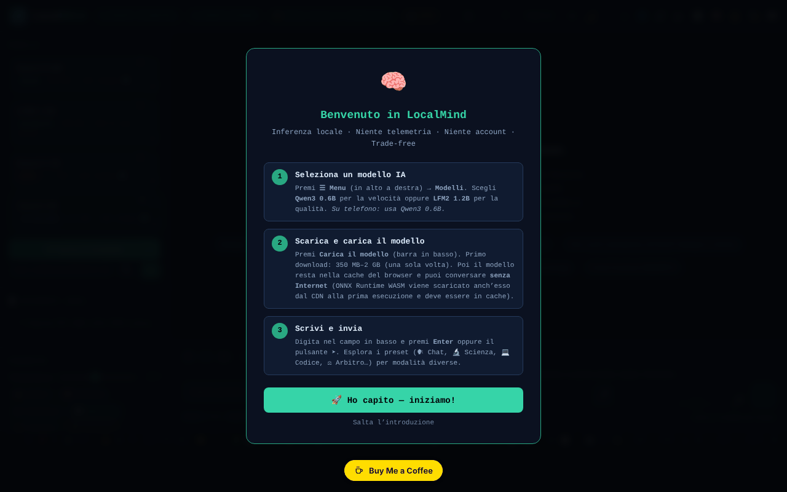

# LocalMind

[English](README.md) · [Română](README.ro.md) · [Français](README.fr.md) · **Italiano** · [Español](README.es.md) · [Português](README.pt.md) · [Deutsch](README.de.md) · [Magyar](README.hu.md)

**Versione:** 120.2.0 · **Ultimo aggiornamento:** 2026-10-19

Lingue dell'interfaccia: **Română, English, Français, Italiano, Español, Português (PT), Deutsch, Magyar**

Un assistente IA che funziona nel browser (transformers.js + WebGPU), senza account e senza chiave API.

**App online:** https://chiuta.github.io/LocalMind/

## Che cos'è

LocalMind (v120 nel titolo della pagina) è un'interfaccia di chat con modelli linguistici che girano in locale nel browser, tramite transformers.js v4.2.0 (WebGPU, con alternativa CPU/WASM dove necessario). Scegli un modello, premi «Încarcă Modelul» (Carica il modello), e il modello viene scaricato una sola volta da Hugging Face e resta nella cache del browser. L'interfaccia è in rumeno e l'app mostra i badge «FĂRĂ TELEMETRIE» (SENZA TELEMETRIA) e «FĂRĂ CONT» (SENZA ACCOUNT) (nelle versioni precedenti: «ZERO TELEMETRY» / «NO ACCOUNT»; riformulati per essere precisi — vedi «Avvertenza»).

## Funzioni

- Modelli predefiniti: Qwen3 0.6B, LFM2 1.2B, Qwen3 1.7B, Qwen3 4B (dimensioni mostrate nell'interfaccia: ~550 MB, ~700 MB, ~1,3 GB, ~2,5 GB), più «Descoperă modele ONNX» (Scopri modelli ONNX; ricerca nel catalogo Hugging Face) e una raccolta curata.
- Chat in streaming, cronologia delle conversazioni, rami/istantanee, fusione di due rami, confronto di due modelli, segnalibri, ricerca nella conversazione.
- Preimpostazioni di stile e di system prompt (Chat, Scienza, Codice, Creativo, Rumeno, Matematica, Traduzione, Riassunto, Socratico ecc.), parametri (temperature, Top-P, penalità di ripetizione, max tokens), variabili `{{date}}`, `{{time}}`, `{{model}}`, `{{name}}`.
- Documenti (RAG): caricamento di TXT / MD / CSV / PDF (pdf.js locale).
- Memoria persistente, budget giornaliero di token, libreria di prompt (esportazione/importazione JSON), timer (Pomodoro, Deep, Sprint), modalità focus.
- Visualizzazione della conversazione (mappa mentale, diagramma), esportazione in TXT / MD / JSON / JSONL / PDF / HTML, esportazione verso Obsidian, Logseq, Notion, variante anonima.
- Rendering di Markdown, KaTeX e Mermaid (caricati su richiesta), esecuzione di codice Python tramite Pyodide (caricato su richiesta).
- Dettatura vocale e lettura ad alta voce (API del browser, dove disponibili), tastiera con scorciatoie.
- «Audit Rețea» (Audit di rete): un pannello che conta le richieste di rete effettuate durante l'inferenza.
- Temi (chiaro/scuro, notturno), modalità Semplice, accessibilità (dimensione del testo, dislessia).

## Novità (120.1.0)

- **🛡 Anonimo verificato (.txt):** prima di esportare una conversazione, l'app la scansiona in locale (`FFF.pii`) e ti mostra che cosa ha trovato; puoi mascherare gli elementi spuntati o esportare senza modifiche. Se non trova nulla, dichiara esplicitamente che il rilevamento è euristico e può mancare qualcosa.
- **🔎 Cerca ovunque:** ricerca locale (BM25, segni diacritici, forme vicine; `FFF.search`) in tutte le conversazioni salvate su questo dispositivo, con frammenti evidenziati, apertura di una conversazione e sua cancellazione. Non viene inviato nulla.
- **🔐 Copia cifrata:** apre l'etichetta di trasparenza per l'esportazione/importazione `.fff.json` con password (AES-GCM, PBKDF2) e la cancellazione dei dati dell'app.
- **Indicatore «🔒 Nulla lascia il dispositivo»:** si basa sul registro di rete dell'app (l'audit esistente) e diventa «⚠ N richieste verso altri host» se compare una richiesta al di fuori di `huggingface.co` / `cdn.jsdelivr.net`. Limite: vede solo le richieste fatte tramite `fetch` della pagina, non tutto il traffico del browser; verifica anche nella scheda Rete.
- **🧪 Valutazione della qualità (onesta):** esegue il **modello reale caricato** su 8 piccoli compiti con risposta verificabile automaticamente (aritmetica, JSON valido, esattamente tre parole, estrazione, lingua, copia esatta, deduzione, astensione), con decodifica deterministica. Mostra il punteggio con un **intervallo di Wilson al 95%**, il tempo fino al primo token e la velocità (mediane misurate sul tuo dispositivo), i dettagli per compito, l'esportazione JSON. Quando gli intervalli di due modelli si sovrappongono, l'app dice che non si può decidere quale sia migliore. Non simula nulla: senza un modello caricato, il pulsante è disattivato.

### Limiti
- 8 compiti sono un segnale grossolano, non una classifica generale dei modelli; i compiti sono in rumeno, e i modelli piccoli possono fallire sul formato, non sulla «comprensione».
- La velocità dipende dal dispositivo, da WebGPU/WASM, dalla temperatura e dalle altre schede aperte.
- Il rilevamento dei dati personali è euristico.

**Kit FFF.** Da `fff-kit` (incorporato in `index.html`, senza rete) si usano i moduli `core, label, bundle, pii, search`: etichetta di trasparenza (premi la versione nel piè di pagina), esportazione/importazione/cancellazione `.fff.json` con cifratura facoltativa AES-GCM + PBKDF2, rilevamento locale dei dati personali e ricerca locale BM25. La politica CSP **non è stata modificata** rispetto alla versione precedente, a parte gli hash `sha256` degli script inline (i nuovi stili sono in `<style>`, coperto dallo `style-src 'unsafe-inline'` già presente; non è stato aggiunto alcun nuovo host). Le traduzioni dei nuovi testi in fr/it/es/pt/hu/de sono automatiche e **non verificate da madrelingua**. Il rilevamento dei dati personali è euristico: può mancare o segnalare erroneamente; non sostituisce la tua verifica.

## Guida all'uso

1. Apri la pagina in un browser con WebGPU (l'app rileva il dispositivo nell'intestazione).
2. Scegli un modello dall'elenco «Model» (per esempio Qwen3 0.6B per un avvio rapido) e premi «⬇ Încarcă Modelul». Il primo caricamento scarica il modello da huggingface.co.
3. Scrivi nel campo del messaggio e invia con `Invio` (`Maiusc+Invio` per andare a capo). `Esc` interrompe la generazione.
4. Regola la preimpostazione di stile, il system prompt e i parametri nel pannello laterale.
5. Per i documenti, trascina un file nell'area «Documente (RAG)» o fai clic su di essa; attiva «RAG activ».
6. Salva ed esporta la conversazione con i pulsanti di esportazione (o `Ctrl+Maiusc+S`, `Ctrl+Maiusc+X`, `Ctrl+Maiusc+J`).
7. Scorciatoie utili: `?` finestra delle scorciatoie, `Alt+M` menu, `Alt+S` modalità Semplice, `Alt+N` modalità notturna, `Alt+L` tema chiaro, `Alt+V` dettatura, `Alt+C` nuova conversazione, `Alt+H` cronologia, `Alt+D` statistiche, `Ctrl+F` cerca, `Ctrl+B` salto al segnalibro, `Alt+1–5` cambio rapido di modello.
8. Apri «Audit Rețea» per vedere le richieste di rete durante la generazione.

## Privacy e rete

- **Archiviazione locale:** `localStorage` (chiavi con prefisso `lm_`: preferenze, conversazioni salvate, libreria di prompt, memoria, budget, benchmark ecc.) e Cache Storage (modelli scaricati da transformers.js e un piccolo service worker per le risorse CDN). Il testo delle conversazioni non viene inviato da nessuna parte dall'app.
- **Rete (host di terzi):**
  - `huggingface.co` (e `*.huggingface.co`, `hf.co`): scaricamento dei modelli ONNX e ricerca nel catalogo, solo quando carichi un modello o cerchi modelli.
  - `cdn.jsdelivr.net`: KaTeX, Mermaid 11.15.0 e Pyodide 0.27.0, caricati solo quando servono (formule, diagrammi, esecuzione di codice Python). La CSP nella pagina consente solo questi host.
  - transformers.js e pdf.js sono inclusi in locale nella cartella `vendor/` del repository.
- L'app dichiara «zero richieste di rete durante l'inferenza»: dopo il caricamento del modello, la generazione gira in locale.

## Avvertenza

Le risposte dei modelli piccoli possono essere sbagliate, incomplete o inventate («allucinazioni»); verificale. L'app non offre consigli medici, legali o finanziari. I badge «FĂRĂ TELEMETRIE» / «FĂRĂ CONT» (il tooltip del badge dice lo stesso) significano che l'app non invia le conversazioni né i dati di utilizzo a un server dell'autore; la pagina contatta tuttavia huggingface.co (scaricamento dei modelli, ricerca) e cdn.jsdelivr.net (KaTeX, Mermaid, Pyodide), come descritto sopra.

## Componenti di terzi

La cartella `vendor/` contiene copie di librerie con licenze proprie, diverse da MIT: pdf.js (Mozilla, Apache-2.0 — l'avviso è nell'intestazione del file), transformers.js 4.2.0 (Hugging Face, Apache-2.0 secondo il progetto a monte; il file minificato non contiene l'avviso) e `qrcode.min.js` (qrcodejs, MIT secondo il progetto a monte; usato per generare codici QR). La licenza MIT si applica al codice dell'autore, non ai componenti di terzi. I modelli scaricati da Hugging Face hanno le proprie licenze (ad es. Qwen3 sotto Apache-2.0, LFM2 sotto la licenza Liquid AI).

## Esecuzione in locale / offline

Scarica l'intera directory (non solo `index.html`, perché gli script transformers.js e pdf.js si trovano in `vendor/`) e servila con un server web locale (ad es. `python3 -m http.server 8080`, poi `http://localhost:8080/`). **Apertura diretta di `index.html` dal file system (`file://`):** l'interfaccia ora si avvia normalmente, ma il caricamento dei modelli è bloccato dal browser (moduli ES da `vendor/`, politica CORS); l'app mostra un messaggio chiaro con i passaggi per il server locale, invece di un'interfaccia inerte (verificato il 2026-10-11). Firefox e Safari possono avere restrizioni simili. Per il primo utilizzo di ogni modello serve internet; dopo, il modello è nella cache. KaTeX, Mermaid e Pyodide richiedono internet al primo utilizzo.

## Licenza

MIT — vedi il file LICENSE. L'intestazione di `index.html` diceva in precedenza anche «TRADE-FREE LICENSE v1.0» (a condizione che le opere derivate restino trade-free); è stata unificata (attualmente MIT), e lo spirito trade-free resta un invito, non una condizione legale. I componenti in `vendor/` restano sotto le proprie licenze (vedi «Componenti di terzi»).

## Audit

2026-10-11 (giro 2): licenza unificata nell'intestazione (attualmente MIT); badge riformulati; tema chiaro riparato (variabili `--sf`, `--sf2`, `--tx3` definite per `body.light-mode`: i pulsanti-suggerimento, `kbd` e le altre superfici non restano più scuri); il pannello «Parametri avanzati» (CSS rimasto in un blocco inutilizzato) ora si nasconde correttamente, con `aria-hidden` vero.

2026-10-10: verificato nel browser (0 errori JS al caricamento; al caricamento non parte alcuna richiesta di rete) e la CSP nella pagina. Aggiunti nomi accessibili, una nota sull'affidabilità dei modelli e le note sulle licenze sopra riportate.

## Cronologia / Changelog

### 120.1.1 — 2026-10-18
- La ricerca nei documenti allegati (RAG) normalizza il testo NFD→NFC e ignora i segni diacritici (ș/ş/s, ă/a; testo NFD di macOS), e le parole di 3 lettere (IMI, RAG) ora vengono considerate (soglia ≥3 invece di >3; «UE», di 2 lettere, resta sotto la soglia).

### 120.1.0 — 2026-10-14
- Esportazione anonima verificata (`FFF.pii`), ricerca in tutte le conversazioni (`FFF.search`), copia cifrata (`FFF.bundle`), indicatore «nulla esce», valutazione della qualità del modello locale con intervalli di confidenza; test in `tests/fff-r8.test.mjs`. Numerazione maggiore v120 mantenuta.

### 120.0.1 — 2026-10-12
- La versione e la data dell'ultimo aggiornamento sono mostrate nell'app (piè della barra laterale); versione 120.0.1 nel titolo, nelle esportazioni e nell'intestazione (numerazione maggiore v120 mantenuta).

### v120 — 11 ottobre 2026 (giro 7)
- Corretto: il pulsante delle preimpostazioni di stile (Chat, Scienza, Codice…) cambiava il prompt di sistema, ma non evidenziava più la preimpostazione attiva (il selettore cercava l'attributo `onclick`, rimosso nel passaggio al dispatcher delegato); ora usa `data-prompt`. Riprodotto e verificato nel browser.
- Versione v120 (titolo, esportazioni, intestazione); hash CSP dello script ricalcolato. `'unsafe-eval'` resta (esecuzione di codice JS e ONNX/WASM).

### v119 — 11 ottobre 2026 (giro 6)
- Sicurezza: tutti i ~300 gestori inline (`onclick=`, `oninput=` ecc.; 242 distinti) sono stati sostituiti con un unico dispatcher delegato (`data-on-*` + uno script classico separato, senza `eval`/`Function`; per il markup generato dinamicamente, gli argomenti passano tramite `data-args` JSON e può essere chiamato solo un elenco fisso di funzioni). La CSP ha ora `script-src` tramite hash SHA-256 (due script), senza `'unsafe-inline'`; `'unsafe-eval'` resta necessario per la funzione «Esegui» dei blocchi di codice JavaScript e `'wasm-unsafe-eval'` per ONNX Runtime.
- Verificata la parità di comportamento: su tutti i 253 elementi con gestori (242 gestori distinti) sono stati scatenati gli eventi originali e sono stati confrontati le chiamate, le modifiche di stile, il DOM e `defaultPrevented`, prima e dopo: 0 differenze.
- Corretto: otto funzioni usate dai gestori (`_highlightSearch`, `_seekTimelineDebounced`, `_checkPromptLength`, `_updateGhostText`, `_trackWPM`, `_checkExpander`, `_updateTypingTokens`, `_runGlobSearch`) erano definite solo nel modulo, quindi i gestori inline lanciavano `ReferenceError` (la ricerca con evidenziazione, il cursore di posizione nella conversazione, la ricerca globale e i controlli durante la digitazione non funzionavano); ora sono esposte su `window`.

### v118 — 11 ottobre 2026
- Corretto: su `file://` l'interfaccia non è più inerte (ReferenceError doLoad/setTemp/useChip): transformers.js si carica su richiesta (import dinamico), e «Încarcă Modelul» mostra un messaggio esplicativo.
- Corretto: il blocco di CSS e HTML per ~24 pannelli (cronologia conversazioni, QR, statistiche, analisi, flashcard, benchmark, ricerca globale, mappa ecc.), che era stato inserito per errore nel template `exportAsHTML()`, è ora in `<head>`/`<body>`; le loro funzioni non sono più inerti, e il campo del titolo della conversazione non compare più come un rettangolo bianco.
- Corretto: su mobile, l'area della chat non è più coperta dalla barra di stato (barra compatta su 3 righe, la schermata di benvenuto scorre invece di spingere il campo del messaggio); il banner «Installa» e la barra di riproduzione non sono più mostrati in permanenza.
- Corretto: una regola CSS corrotta, `<h1>` per il titolo dell'app, `<header>`/`<footer>` e un'etichetta per il campo dell'ID del modello; 0 violazioni axe-core a 1280 e 360 px.
- Invariato: i gestori `onclick` inline (≈300) e `eval`/`new Function` dell'esecuzione dei blocchi di codice restano (la CSP consente `'unsafe-inline'`); rimuoverli richiede un refactoring più ampio.

## Autore

Alexio — Alexandru-Ionuț Chiuță, contatto: alexio@trom.tf

## English summary

LocalMind is a browser-based chat UI for small language models (Qwen3, LFM2) running via transformers.js and WebGPU, with RAG over local documents, conversation branching, exports and a network audit panel. Models are downloaded once from huggingface.co; KaTeX, Mermaid and Pyodide load on demand from cdn.jsdelivr.net; transformers.js and pdf.js are vendored locally. Settings and chats live in localStorage (`lm_` keys). UI is Romanian.
