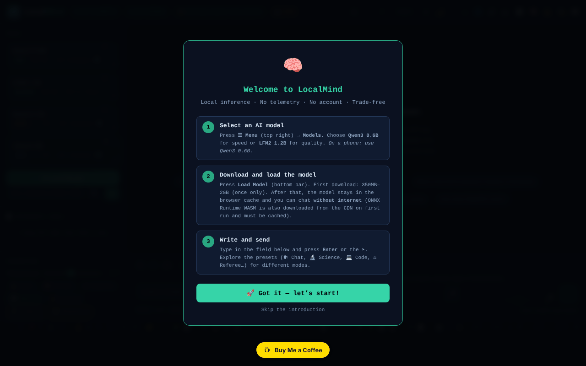

# LocalMind

**English** · [Română](README.ro.md) · [Français](README.fr.md) · [Italiano](README.it.md) · [Español](README.es.md) · [Português](README.pt.md) · [Deutsch](README.de.md) · [Magyar](README.hu.md)

**Version:** 120.2.7 · **Last updated:** 2026-10-22

Interface languages: **Română, English, Français, Italiano, Español, Português (PT), Deutsch, Magyar**

An AI assistant that runs in the browser (transformers.js + WebGPU), with no account and no API key.

**Live app:** https://chiuta.github.io/LocalMind/

## What it is

LocalMind (v120 in the page title) is a chat interface with language models that run locally in the browser, through transformers.js v4.2.0 (WebGPU, with a CPU/WASM fallback where applicable). You choose a model, press "Încarcă Modelul" (Load the Model), and the model is downloaded once from Hugging Face and stays in the browser cache. The interface is in Romanian, and the app displays "FĂRĂ TELEMETRIE" (NO TELEMETRY) and "FĂRĂ CONT" (NO ACCOUNT) badges (in earlier versions: "ZERO TELEMETRY" / "NO ACCOUNT"; reworded to be precise — see "Disclaimer").

## Features

- Preset models: Qwen3 0.6B, LFM2 1.2B, Qwen3 1.7B, Qwen3 4B (sizes shown in the interface: ~550 MB, ~700 MB, ~1.3 GB, ~2.5 GB), plus "Descoperă modele ONNX" (Discover ONNX models; search in the Hugging Face catalog) and a curated collection.
- Streaming chat, conversation history, branches/snapshots, merging two branches, comparing two models, bookmarks, search within a conversation.
- Style and system prompt presets (Chat, Science, Code, Creative, Romanian, Math, Translation, Summary, Socratic etc.), parameters (temperature, Top-P, repetition penalty, max tokens), variables `{{date}}`, `{{time}}`, `{{model}}`, `{{name}}`.
- Documents (RAG): uploading TXT / MD / CSV / PDF (local pdf.js).
- Persistent memory, daily token budget, prompt library (JSON export/import), timers (Pomodoro, Deep, Sprint), focus mode.
- Conversation visualization (mind map, diagram), export to TXT / MD / JSON / JSONL / PDF / HTML, export to Obsidian, Logseq, Notion, the anonymous variant.
- Markdown, KaTeX and Mermaid rendering (loaded on demand), running Python code through Pyodide (loaded on demand).
- Voice dictation and text-to-speech (browser APIs, where available), keyboard with shortcuts.
- "Audit Rețea" (Network Audit): a panel that counts the network requests made during inference.
- Themes (light/dark, night), Simple mode, accessibility (text size, dyslexia).

## New features (120.1.0)

- **🛡 Verified anonymous (.txt):** before exporting a conversation, the app scans it locally (`FFF.pii`) and shows you what it found; you can mask the ticked items or export unchanged. If it finds nothing, it says explicitly that the detection is heuristic and may miss something.
- **🔎 Search everything:** local search (BM25, diacritics, close forms; `FFF.search`) across all the conversations saved on this device, with highlighted snippets, opening a conversation and deleting it. Nothing is sent.
- **🔐 Encrypted copy:** opens the transparency label for `.fff.json` export/import with a password (AES-GCM, PBKDF2) and deleting the app's data.
- **"🔒 Nothing leaves the device" indicator:** based on the app's network log (the existing audit) and becomes "⚠ N requests to other hosts" if any request appears outside `huggingface.co` / `cdn.jsdelivr.net`. Limit: it sees only the requests made through the page's `fetch`, not all of the browser's traffic; also check in the Network tab.
- **🧪 Quality evaluation (honest):** runs the **actual loaded model** on 8 small tasks with an automatically verifiable answer (arithmetic, valid JSON, exactly three words, extraction, language, exact copying, deduction, abstention), with deterministic decoding. It shows the score with a **95% Wilson interval**, the time to first token and the speed (medians measured on your device), per-task details, JSON export. When the intervals of two models overlap, the app says it cannot be decided which is better. It simulates nothing: without a loaded model, the button is disabled.

### Limits
- 8 tasks are a coarse signal, not a general ranking of models; the tasks are in Romanian, and the small ones may fail on format, not on "understanding".
- Speed depends on the device, WebGPU/WASM, temperature and other open tabs.
- Personal data detection is heuristic.

**FFF kit.** From `fff-kit` (pasted into `index.html`, no network) the modules `core, label, bundle, pii, search` are used: a transparency label (press the version in the footer), `.fff.json` export/import/deletion with optional AES-GCM + PBKDF2 encryption, local personal data detection and local BM25 search. The CSP policy **was not changed** from the previous version apart from the `sha256` hashes of the inline scripts (the new styles are in `<style>`, covered by the `style-src 'unsafe-inline'` already present; no new host was added). The translations of the new texts into fr/it/es/pt/hu/de are automatic and **not checked by native speakers**. Personal data detection is heuristic: it may miss or wrongly flag; it does not replace your own check.

## User guide

1. Open the page in a browser with WebGPU (the app detects the device in the header).
2. Choose a model from the "Model" list (for example Qwen3 0.6B for a quick start) and press "⬇ Încarcă Modelul". The first load downloads the model from huggingface.co.
3. Type in the message field and send with `Enter` (`Shift+Enter` for a new line). `Escape` stops the generation.
4. Adjust the style preset, the system prompt and the parameters in the side panel.
5. For documents, drag a file into the "Documente (RAG)" area or click it; enable "RAG activ".
6. Save and export the conversation with the export buttons (or `Ctrl+Shift+S`, `Ctrl+Shift+X`, `Ctrl+Shift+J`).
7. Useful shortcuts: `?` shortcuts window, `Alt+M` menu, `Alt+S` Simple mode, `Alt+N` night mode, `Alt+L` light theme, `Alt+V` dictation, `Alt+C` new conversation, `Alt+H` history, `Alt+D` statistics, `Ctrl+F` search, `Ctrl+B` jump to bookmark, `Alt+1–5` quick model switch.
8. Open "Audit Rețea" to see the network requests during generation.

## Privacy and network

- **Local storage:** `localStorage` (keys with the prefix `lm_`: preferences, saved conversations, prompt library, memory, budget, benchmarks etc.) and Cache Storage (models downloaded by transformers.js and a small service worker for CDN resources). The text of the conversations is not sent anywhere by the app.
- **Network (third-party hosts):**
  - `huggingface.co` (and `*.huggingface.co`, `hf.co`): downloading ONNX models and searching the catalog, only when you load a model or search for models.
  - `cdn.jsdelivr.net`: KaTeX, Mermaid 11.15.0 and Pyodide 0.27.0, loaded only when needed (formulas, diagrams, running Python code). The CSP in the page allows only these hosts.
  - transformers.js and pdf.js are included locally in the `vendor/` folder of the repository.
- The app states "zero network requests during inference": after the model is loaded, generation runs locally.

## Disclaimer

The answers of small models can be wrong, incomplete or made up ("hallucinations"); verify them. The app does not provide medical, legal or financial advice. The "FĂRĂ TELEMETRIE" / "FĂRĂ CONT" badges (the badge tooltip says the same) mean that the app does not send conversations or usage data to a server of the author; the page does, however, contact huggingface.co (model download, search) and cdn.jsdelivr.net (KaTeX, Mermaid, Pyodide), as described above.

## Third-party components

The `vendor/` folder contains copies of libraries with their own licenses, different from MIT: pdf.js (Mozilla, Apache-2.0 — the notice is in the file header), transformers.js 4.2.0 (Hugging Face, Apache-2.0 according to the upstream project; the minified file does not contain the notice) and `qrcode.min.js` (qrcodejs, MIT according to the upstream project; used to generate QR codes). The MIT license applies to the author's code, not to the third-party components. The models downloaded from Hugging Face have their own licenses (e.g. Qwen3 under Apache-2.0, LFM2 under the Liquid AI license).

## Running locally / offline

Download the whole directory (not just `index.html`, because the transformers.js and pdf.js scripts are in `vendor/`) and serve it with a local web server (e.g. `python3 -m http.server 8080`, then `http://localhost:8080/`). **Opening `index.html` directly from the file system (`file://`):** the interface now starts normally, but loading models is blocked by the browser (ES modules from `vendor/`, CORS policy); the app displays a clear message with the steps for the local server, instead of an inert interface (verified 2026-10-11). Firefox and Safari may have similar restrictions. Internet is needed the first time each model is used; after that the model is in the cache. KaTeX, Mermaid and Pyodide need internet on first use.

See also: [VENDOR-README.md](VENDOR-README.md) — Vendoring notes (what is bundled locally, how to go fully offline; in Romanian).

## License

MIT — see the LICENSE file. The `index.html` header used to also say "TRADE-FREE LICENSE v1.0" (on condition that derivatives remain trade-free); it was unified (currently MIT), and the trade-free spirit remains an invitation, not a legal condition. The components in `vendor/` remain under their own licenses (see "Third-party components").

## Audit

2026-10-11 (round 2): license unified in the header (currently MIT); badges reworded; light theme fixed (the variables `--sf`, `--sf2`, `--tx3` defined for `body.light-mode`: the suggestion buttons, `kbd` and the other surfaces no longer stay dark); the "Advanced parameters" panel (CSS left in an unused block) now hides correctly, with a true `aria-hidden`.

2026-10-10: verified in the browser (0 JS errors on load; no network requests leave on load) and the CSP in the page. Added accessible names, a note on the reliability of the models and the license notes above.

## History / Changelog

### 120.2.7 — 2026-10-22
- Security: the global search and the in-conversation search no longer insert the typed query or the message text as HTML (latent DOM-XSS); results are built from text nodes.

### 120.2.6 — 2026-10-22

fff-kit 1.1.2: PBKDF2 with 600,000 iterations, anti-clickjacking protection.

### 120.2.5 — 2026-10-22
- Native dialogs (confirm/prompt/alert) replaced by in-page dialogs, translated; mobile: scrollable top bar (all buttons reachable), touch targets ≥ 24 px, text ≥ 12 px, onboarding no longer covered by the donate button; real `sw.js` + manifest + icons (offline shell after the first visit) instead of the invalid blob: service worker; on Chrome Android, an experimental “Try anyway with Qwen2.5 0.5B (~300MB)” option instead of a hard block.

### 120.2.4 — 2026-10-22
- The “nothing leaves the device” badge (text and tooltip) and the “Encrypted copy” button now re-translate immediately when the language is changed, without a reload. The system prompt and the example chips intentionally stay in Romanian.

### 120.2.3 — 2026-10-22
- keyboard-shortcuts panel (title, aria-label and all rows) and the sidebar label fully localized in all 8 languages; the default system prompt stays in Romanian by design.

### 120.1.1 — 2026-10-18
- Search in the attached documents (RAG) normalizes the text NFD→NFC and ignores diacritics (ș/ş/s, ă/a; NFD text from macOS), and 3-letter words (IMI, RAG) now count (threshold ≥3 instead of >3; "UE", with 2 letters, stays below the threshold).

### 120.1.0 — 2026-10-14
- Verified anonymous export (`FFF.pii`), search across all conversations (`FFF.search`), encrypted copy (`FFF.bundle`), "nothing leaves" indicator, local model quality evaluation with confidence intervals; tests in `tests/fff-r8.test.mjs`. The major numbering v120 kept.

### 120.0.1 — 2026-10-12
- The version and the date of the last update are shown in the app (sidebar footer); version 120.0.1 in the title, exports and header (major numbering v120 kept).

### v120 — 11 October 2026 (round 7)
- Fixed: the style presets button (Chat, Science, Code…) changed the system prompt but no longer highlighted the active preset (the selector looked for the `onclick` attribute, removed in the switch to the delegated dispatcher); it now uses `data-prompt`. Reproduced and verified in the browser.
- Version v120 (title, exports, header); the CSP hash of the script recomputed. `'unsafe-eval'` remains (JS code execution and ONNX/WASM).

### v119 — 11 October 2026 (round 6)
- Security: all of the ~300 inline handlers (`onclick=`, `oninput=` etc.; 242 distinct) were replaced with a single delegated dispatcher (`data-on-*` + a separate classic script, without `eval`/`Function`; for dynamically generated markup, the arguments pass through JSON `data-args` and only a fixed list of functions can be called). The CSP now has `script-src` by SHA-256 hash (two scripts), without `'unsafe-inline'`; `'unsafe-eval'` remains necessary for the "Run" function of the JavaScript code blocks and `'wasm-unsafe-eval'` for ONNX Runtime.
- Verified behavior parity: on all 253 elements with handlers (242 distinct handlers) the original events were fired and the calls, style changes, DOM and `defaultPrevented` were compared, before and after: 0 differences.
- Fixed: eight functions used by handlers (`_highlightSearch`, `_seekTimelineDebounced`, `_checkPromptLength`, `_updateGhostText`, `_trackWPM`, `_checkExpander`, `_updateTypingTokens`, `_runGlobSearch`) were defined only in the module, so the inline handlers threw `ReferenceError` (search with highlighting, the position slider in the conversation, global search and the typing checks did not run); they are now exposed on `window`.

### v118 — 11 October 2026
- Fixed: on `file://` the interface is no longer inert (ReferenceError doLoad/setTemp/useChip): transformers.js loads on demand (dynamic import), and "Încarcă Modelul" displays an explanatory message.
- Fixed: the CSS and HTML block for ~24 panels (conversation history, QR, statistics, analyses, flashcards, benchmark, global search, map etc.), which had been inserted by mistake into the `exportAsHTML()` template, is now in `<head>`/`<body>`; their functions are no longer inert, and the conversation title field no longer appears as a white rectangle.
- Fixed: on mobile, the chat area is no longer covered by the status bar (compact 3-row bar, the welcome screen scrolls instead of pushing the message field); the "Install" banner and the playback bar are no longer displayed permanently.
- Fixed: a corrupted CSS rule, `<h1>` for the app title, `<header>`/`<footer>` and a label for the model ID field; 0 axe-core violations at 1280 and 360 px.
- Unchanged: the inline `onclick` handlers (≈300) and `eval`/`new Function` from running code blocks remain (CSP allows `'unsafe-inline'`); removing them requires a broader refactoring.

## Author

Alexio — Alexandru-Ionuț Chiuță, contact: alexio@trom.tf

## English summary

LocalMind is a browser-based chat UI for small language models (Qwen3, LFM2) running via transformers.js and WebGPU, with RAG over local documents, conversation branching, exports and a network audit panel. Models are downloaded once from huggingface.co; KaTeX, Mermaid and Pyodide load on demand from cdn.jsdelivr.net; transformers.js and pdf.js are vendored locally. Settings and chats live in localStorage (`lm_` keys). UI is Romanian.
