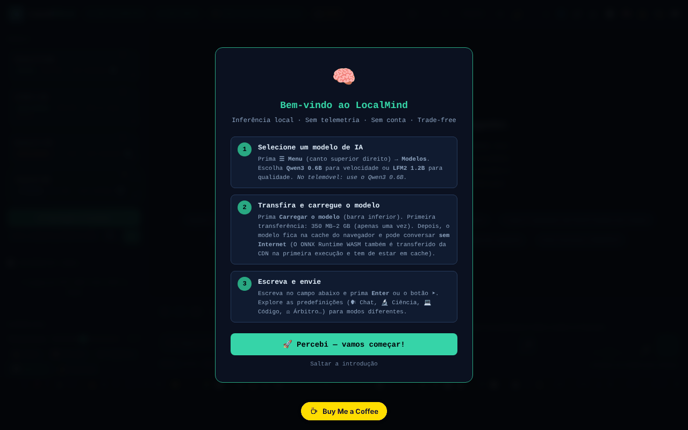

# LocalMind

[English](README.md) · [Română](README.ro.md) · [Français](README.fr.md) · [Italiano](README.it.md) · [Español](README.es.md) · **Português** · [Deutsch](README.de.md) · [Magyar](README.hu.md)

**Versão:** 120.2.5 · **Última atualização:** 2026-10-22

Idiomas da interface: **Română, English, Français, Italiano, Español, Português (PT), Deutsch, Magyar**

Um assistente de IA que corre no navegador (transformers.js + WebGPU), sem conta e sem chave de API.

**Aplicação online:** https://chiuta.github.io/LocalMind/

## O que é

O LocalMind (v120 no título da página) é uma interface de conversa com modelos de linguagem que correm localmente no navegador, através do transformers.js v4.2.0 (WebGPU, com alternativa CPU/WASM onde aplicável). Escolhe um modelo, prime «Încarcă Modelul» (Carregar o modelo), e o modelo é descarregado uma só vez do Hugging Face e fica na cache do navegador. A interface está em romeno, e a aplicação apresenta os emblemas «FĂRĂ TELEMETRIE» (SEM TELEMETRIA) e «FĂRĂ CONT» (SEM CONTA) (em versões anteriores: «ZERO TELEMETRY» / «NO ACCOUNT»; reformulados para serem rigorosos — ver «Aviso»).

## Funcionalidades

- Modelos predefinidos: Qwen3 0.6B, LFM2 1.2B, Qwen3 1.7B, Qwen3 4B (tamanhos apresentados na interface: ~550 MB, ~700 MB, ~1,3 GB, ~2,5 GB), mais «Descoperă modele ONNX» (Descobrir modelos ONNX; pesquisa no catálogo do Hugging Face) e uma coleção selecionada.
- Conversa com streaming, histórico de conversas, ramos/instantâneos, fusão de dois ramos, comparação de dois modelos, marcadores, pesquisa na conversa.
- Predefinições de estilo e de system prompt (Chat, Ciência, Código, Criativo, Romeno, Matemática, Tradução, Resumo, Socrático, etc.), parâmetros (temperature, Top-P, penalização de repetição, max tokens), variáveis `{{date}}`, `{{time}}`, `{{model}}`, `{{name}}`.
- Documentos (RAG): carregamento de TXT / MD / CSV / PDF (pdf.js local).
- Memória persistente, orçamento diário de tokens, biblioteca de prompts (exportação/importação JSON), temporizadores (Pomodoro, Deep, Sprint), modo foco.
- Visualização da conversa (mapa mental, diagrama), exportação para TXT / MD / JSON / JSONL / PDF / HTML, exportação para Obsidian, Logseq, Notion, variante anónima.
- Renderização de Markdown, KaTeX e Mermaid (carregados a pedido), execução de código Python através do Pyodide (carregado a pedido).
- Ditado por voz e leitura em voz alta (APIs do navegador, onde existirem), teclado com atalhos.
- «Audit Rețea» (Auditoria de rede): um painel que conta os pedidos de rede feitos durante a inferência.
- Temas (claro/escuro, noturno), modo Simples, acessibilidade (tamanho do texto, dislexia).

## Novidades (120.1.0)

- **🛡 Anónimo verificado (.txt):** antes de exportar uma conversa, a aplicação analisa-a localmente (`FFF.pii`) e mostra-lhe o que encontrou; pode mascarar os elementos assinalados ou exportar sem alterações. Se não encontrar nada, diz explicitamente que a deteção é heurística e pode falhar alguma coisa.
- **🔎 Pesquisar tudo:** pesquisa local (BM25, sinais diacríticos, formas próximas; `FFF.search`) em todas as conversas guardadas neste dispositivo, com excertos realçados, abertura de uma conversa e a sua eliminação. Nada é enviado.
- **🔐 Cópia cifrada:** abre a etiqueta de transparência para a exportação/importação `.fff.json` com palavra-passe (AES-GCM, PBKDF2) e o apagamento dos dados da aplicação.
- **Indicador «🔒 Nada sai do dispositivo»:** baseia-se no registo de rede da aplicação (a auditoria existente) e passa a «⚠ N pedidos a outros anfitriões» se surgir algum pedido fora de `huggingface.co` / `cdn.jsdelivr.net`. Limite: só vê os pedidos feitos através do `fetch` da página, não todo o tráfego do navegador; verifique também no separador Rede.
- **🧪 Avaliação da qualidade (honesta):** executa o **modelo real carregado** em 8 pequenas tarefas com resposta verificável automaticamente (aritmética, JSON válido, exatamente três palavras, extração, idioma, cópia exata, dedução, abstenção), com descodificação determinista. Apresenta a pontuação com um **intervalo de Wilson a 95 %**, o tempo até ao primeiro token e a velocidade (medianas medidas no seu dispositivo), os pormenores por tarefa e a exportação JSON. Quando os intervalos de dois modelos se sobrepõem, a aplicação diz que não é possível decidir qual é melhor. Não simula nada: sem um modelo carregado, o botão está desativado.

### Limites
- 8 tarefas são um sinal grosseiro, não uma classificação geral de modelos; as tarefas estão em romeno, e os modelos pequenos podem falhar no formato, não na «compreensão».
- A velocidade depende do dispositivo, do WebGPU/WASM, da temperatura e de outros separadores abertos.
- A deteção de dados pessoais é heurística.

**Kit FFF.** Do `fff-kit` (integrado no `index.html`, sem rede) usam-se os módulos `core, label, bundle, pii, search`: etiqueta de transparência (prima a versão no rodapé), exportação/importação/apagamento `.fff.json` com cifragem opcional AES-GCM + PBKDF2, deteção local de dados pessoais e pesquisa local BM25. A política CSP **não foi alterada** em relação à versão anterior, exceto os hashes `sha256` dos scripts inline (os novos estilos estão em `<style>`, coberto pelo `style-src 'unsafe-inline'` já presente; não foi adicionado nenhum anfitrião novo). As traduções dos novos textos para fr/it/es/pt/hu/de são automáticas e **não foram verificadas por falantes nativos**. A deteção de dados pessoais é heurística: pode falhar ou assinalar erradamente; não substitui a sua própria verificação.

## Manual de utilização

1. Abra a página num navegador com WebGPU (a aplicação deteta o dispositivo no cabeçalho).
2. Escolha um modelo na lista «Model» (por exemplo Qwen3 0.6B para um arranque rápido) e prima «⬇ Încarcă Modelul». O primeiro carregamento descarrega o modelo de huggingface.co.
3. Escreva no campo de mensagem e envie com `Enter` (`Shift+Enter` para uma nova linha). `Escape` interrompe a geração.
4. Ajuste a predefinição de estilo, o system prompt e os parâmetros no painel lateral.
5. Para os documentos, arraste um ficheiro para a zona «Documente (RAG)» ou clique nela; ative «RAG activ».
6. Guarde e exporte a conversa com os botões de exportação (ou `Ctrl+Shift+S`, `Ctrl+Shift+X`, `Ctrl+Shift+J`).
7. Atalhos úteis: `?` janela de atalhos, `Alt+M` menu, `Alt+S` modo Simples, `Alt+N` modo noturno, `Alt+L` tema claro, `Alt+V` ditado, `Alt+C` nova conversa, `Alt+H` histórico, `Alt+D` estatísticas, `Ctrl+F` pesquisar, `Ctrl+B` salto para o marcador, `Alt+1–5` troca rápida de modelo.
8. Abra «Audit Rețea» para ver os pedidos de rede durante a geração.

## Privacidade e rede

- **Armazenamento local:** `localStorage` (chaves com o prefixo `lm_`: preferências, conversas guardadas, biblioteca de prompts, memória, orçamento, benchmarks, etc.) e Cache Storage (modelos descarregados pelo transformers.js e um pequeno service worker para recursos de CDN). O texto das conversas não é enviado para lado nenhum pela aplicação.
- **Rede (anfitriões de terceiros):**
  - `huggingface.co` (e `*.huggingface.co`, `hf.co`): descarregamento de modelos ONNX e pesquisa no catálogo, apenas quando carrega um modelo ou pesquisa modelos.
  - `cdn.jsdelivr.net`: KaTeX, Mermaid 11.15.0 e Pyodide 0.27.0, carregados apenas quando necessários (fórmulas, diagramas, execução de código Python). A CSP da página permite apenas estes anfitriões.
  - O transformers.js e o pdf.js estão incluídos localmente na pasta `vendor/` do repositório.
- A aplicação afirma «zero pedidos de rede na inferência»: depois de o modelo ser carregado, a geração corre localmente.

## Aviso

As respostas dos modelos pequenos podem ser erradas, incompletas ou inventadas («alucinações»); verifique-as. A aplicação não fornece aconselhamento médico, jurídico ou financeiro. Os emblemas «FĂRĂ TELEMETRIE» / «FĂRĂ CONT» (a dica do emblema diz o mesmo) referem-se ao facto de a aplicação não enviar as conversas nem dados de utilização para um servidor do autor; a página contacta, contudo, o huggingface.co (descarregamento de modelos, pesquisa) e o cdn.jsdelivr.net (KaTeX, Mermaid, Pyodide), conforme descrito acima.

## Componentes de terceiros

A pasta `vendor/` contém cópias de bibliotecas com licenças próprias, diferentes de MIT: pdf.js (Mozilla, Apache-2.0 — o aviso está no cabeçalho do ficheiro), transformers.js 4.2.0 (Hugging Face, Apache-2.0 segundo o projeto de origem; o ficheiro minificado não contém o aviso) e `qrcode.min.js` (qrcodejs, MIT segundo o projeto de origem; usado para gerar códigos QR). A licença MIT aplica-se ao código do autor, não aos componentes de terceiros. Os modelos descarregados do Hugging Face têm as suas próprias licenças (p. ex., Qwen3 sob Apache-2.0, LFM2 sob a licença da Liquid AI).

## Execução local / offline

Descarregue a diretoria inteira (não apenas o `index.html`, porque os scripts do transformers.js e do pdf.js estão em `vendor/`) e sirva-a com um servidor web local (p. ex. `python3 -m http.server 8080`, depois `http://localhost:8080/`). **Abertura direta do `index.html` a partir do sistema de ficheiros (`file://`):** a interface arranca agora normalmente, mas o carregamento de modelos é bloqueado pelo navegador (módulos ES de `vendor/`, política CORS); a aplicação apresenta uma mensagem clara com os passos para o servidor local, em vez de uma interface inerte (verificado a 2026-10-11). O Firefox e o Safari podem ter restrições semelhantes. É necessária internet na primeira utilização de cada modelo; depois disso o modelo está na cache. O KaTeX, o Mermaid e o Pyodide precisam de internet na primeira utilização.

Ver também: [VENDOR-README.md](VENDOR-README.md) — Notas sobre o vendoring (o que está incluído localmente, como funcionar 100 % offline; em romeno).

## Licença

MIT — ver o ficheiro LICENSE. O cabeçalho do `index.html` dizia anteriormente também «TRADE-FREE LICENSE v1.0» (com a condição de que as obras derivadas permanecessem trade-free); foi unificado (atualmente MIT), e o espírito trade-free continua a ser um convite, não uma condição legal. Os componentes de `vendor/` permanecem sob as suas próprias licenças (ver «Componentes de terceiros»).

## Auditoria

2026-10-11 (ronda 2): licença unificada no cabeçalho (atualmente MIT); emblemas reformulados; tema claro reparado (variáveis `--sf`, `--sf2`, `--tx3` definidas para `body.light-mode`: os botões de sugestão, `kbd` e as outras superfícies já não ficam escuros); o painel «Parâmetros avançados» (CSS que ficou num bloco não utilizado) esconde-se agora corretamente, com `aria-hidden` verdadeiro.

2026-10-10: verificado no navegador (0 erros de JS ao carregar; ao carregar não sai nenhum pedido de rede) e a CSP da página. Adicionados nomes acessíveis, uma nota sobre a fiabilidade dos modelos e as notas sobre licenças acima.

## Histórico / Changelog

### 120.2.5 — 2026-10-22
- Os diálogos nativos (confirm/prompt/alert) foram substituídos por diálogos integrados e traduzidos; telemóvel: barra superior deslizável (todos os botões acessíveis), áreas táteis ≥ 24 px, texto ≥ 12 px, a introdução já não é tapada pelo botão de donativos; `sw.js` real + manifesto + ícones (estrutura offline após a primeira visita) em vez do service worker blob: inválido; no Chrome Android, opção experimental «Tentar mesmo assim com Qwen2.5 0.5B (~300MB)» em vez de um bloqueio total.

### 120.2.4 — 2026-10-22
- O distintivo «nada sai do dispositivo» (texto e tooltip) e o botão «Cópia cifrada» passam a ser retraduzidos de imediato ao mudar de língua, sem recarregar. O prompt do sistema e os chips de exemplo permanecem propositadamente em romeno.

### 120.2.3 — 2026-10-22
- o painel de atalhos de teclado (título, aria-label e todas as linhas) e a etiqueta da barra lateral estão totalmente localizados nos 8 idiomas; o prompt de sistema predefinido permanece em romeno, de propósito.

### 120.1.1 — 2026-10-18
- A pesquisa nos documentos anexados (RAG) normaliza o texto NFD→NFC e ignora os sinais diacríticos (ș/ş/s, ă/a; texto NFD do macOS), e as palavras de 3 letras (IMI, RAG) passam a contar (limiar ≥3 em vez de >3; «UE», de 2 letras, fica abaixo do limiar).

### 120.1.0 — 2026-10-14
- Exportação anónima verificada (`FFF.pii`), pesquisa em todas as conversas (`FFF.search`), cópia cifrada (`FFF.bundle`), indicador «nada sai», avaliação da qualidade do modelo local com intervalos de confiança; testes em `tests/fff-r8.test.mjs`. Numeração principal v120 mantida.

### 120.0.1 — 2026-10-12
- A versão e a data da última atualização são apresentadas na aplicação (rodapé da barra lateral); versão 120.0.1 no título, nas exportações e no cabeçalho (numeração principal v120 mantida).

### v120 — 11 de outubro de 2026 (ronda 7)
- Corrigido: o botão das predefinições de estilo (Chat, Ciência, Código…) mudava o prompt de sistema, mas deixara de realçar a predefinição ativa (o seletor procurava o atributo `onclick`, removido na passagem ao despachante delegado); passa agora a usar `data-prompt`. Reproduzido e verificado no navegador.
- Versão v120 (título, exportações, cabeçalho); hash CSP do script recalculado. `'unsafe-eval'` mantém-se (execução de código JS e ONNX/WASM).

### v119 — 11 de outubro de 2026 (ronda 6)
- Segurança: todos os ~300 manipuladores inline (`onclick=`, `oninput=`, etc.; 242 distintos) foram substituídos por um único despachante delegado (`data-on-*` + um script clássico separado, sem `eval`/`Function`; para marcação gerada dinamicamente, os argumentos passam por `data-args` JSON e só pode ser chamada uma lista fixa de funções). A CSP tem agora `script-src` por hash SHA-256 (dois scripts), sem `'unsafe-inline'`; `'unsafe-eval'` continua necessário para a função «Executar» dos blocos de código JavaScript e `'wasm-unsafe-eval'` para o ONNX Runtime.
- Verificada a paridade de comportamento: em todos os 253 elementos com manipuladores (242 manipuladores distintos) foram disparados os eventos originais e comparados as chamadas, as alterações de estilo, o DOM e `defaultPrevented`, antes e depois: 0 diferenças.
- Corrigido: oito funções usadas pelos manipuladores (`_highlightSearch`, `_seekTimelineDebounced`, `_checkPromptLength`, `_updateGhostText`, `_trackWPM`, `_checkExpander`, `_updateTypingTokens`, `_runGlobSearch`) estavam definidas apenas no módulo, pelo que os manipuladores inline lançavam `ReferenceError` (a pesquisa com realce, o controlo deslizante de posição na conversa, a pesquisa global e as verificações ao escrever não corriam); estão agora expostas em `window`.

### v118 — 11 de outubro de 2026
- Corrigido: em `file://` a interface já não está inerte (ReferenceError doLoad/setTemp/useChip): o transformers.js carrega-se a pedido (importação dinâmica), e «Încarcă Modelul» apresenta uma mensagem explicativa.
- Corrigido: o bloco de CSS e HTML de ~24 painéis (histórico de conversas, QR, estatísticas, análises, cartões de estudo, benchmark, pesquisa global, mapa, etc.), que fora inserido por engano no modelo `exportAsHTML()`, está agora em `<head>`/`<body>`; as suas funções já não estão inertes, e o campo do título da conversa já não aparece como um retângulo branco.
- Corrigido: no telemóvel, a área de conversa já não é coberta pela barra de estado (barra compacta em 3 linhas, o ecrã de boas-vindas desloca-se em vez de empurrar o campo de mensagem); o banner «Instalar» e a barra de reprodução já não são apresentados permanentemente.
- Corrigido: uma regra CSS corrompida, `<h1>` para o título da aplicação, `<header>`/`<footer>` e uma etiqueta para o campo do ID do modelo; 0 violações do axe-core a 1280 e 360 px.
- Inalterado: os manipuladores `onclick` inline (≈300) e `eval`/`new Function` da execução de blocos de código mantêm-se (a CSP permite `'unsafe-inline'`); removê-los exige uma refatorização mais ampla.

## Autor

Alexio — Alexandru-Ionuț Chiuță, contacto: alexio@trom.tf

## Resumo

O LocalMind é uma interface de conversação no navegador para pequenos modelos de linguagem (Qwen3, LFM2) executados com transformers.js e WebGPU, com RAG sobre documentos locais, ramificação de conversas, exportações e um painel de auditoria de rede. Os modelos são descarregados uma só vez de huggingface.co; KaTeX, Mermaid e Pyodide são carregados a pedido a partir de cdn.jsdelivr.net; transformers.js e pdf.js estão incluídos localmente. As definições e as conversas ficam em localStorage (chaves `lm_`). A interface está em romeno.
