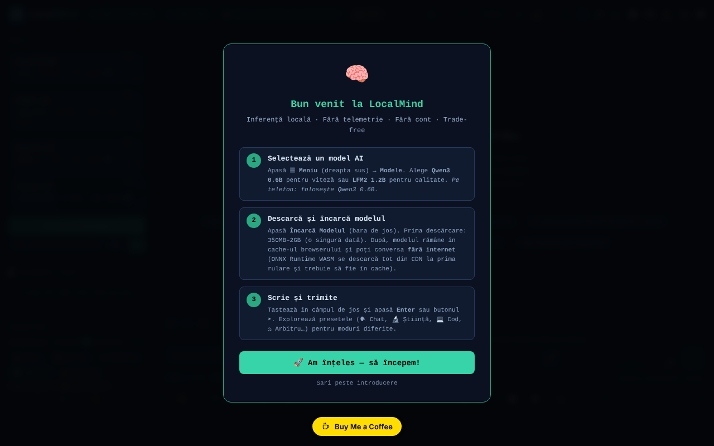

# LocalMind

[English](README.md) · **Română** · [Français](README.fr.md) · [Italiano](README.it.md) · [Español](README.es.md) · [Português](README.pt.md) · [Deutsch](README.de.md) · [Magyar](README.hu.md)

**Versiune:** 120.2.7 · **Ultima actualizare:** 2026-10-22

Limbile interfeței: **Română, English, Français, Italiano, Español, Português (PT), Deutsch, Magyar**

Asistent AI care rulează în browser (transformers.js + WebGPU), fără cont și fără cheie API.

**Live:** https://chiuta.github.io/LocalMind/

## Ce este

LocalMind (v120 în titlul paginii) este o interfață de chat cu modele de limbaj care rulează local în browser, prin transformers.js v4.2.0 (WebGPU, cu alternativă CPU/WASM acolo unde este cazul). Alegi un model, apeși „Încarcă Modelul”, iar modelul se descarcă o singură dată de la Hugging Face și rămâne în cache-ul browserului. Interfața este în română, iar aplicația afișează insigne „FĂRĂ TELEMETRIE” și „FĂRĂ CONT” (în versiunile anterioare: „ZERO TELEMETRY” / „NO ACCOUNT”; reformulate pentru a fi precise — vezi „Avertisment”).

## Funcții

- Modele predefinite: Qwen3 0.6B, LFM2 1.2B, Qwen3 1.7B, Qwen3 4B (dimensiuni afișate în interfață: ~550 MB, ~700 MB, ~1.3 GB, ~2.5 GB), plus „Descoperă modele ONNX” (căutare în catalogul Hugging Face) și o colecție curată.
- Chat cu streaming, istoric de conversații, ramuri/snapshot-uri, fuzionarea a două ramuri, comparare a două modele, bookmark-uri, căutare în conversație.
- Presetări de stil și de system prompt (Chat, Știință, Cod, Creativ, Română, Mate, Traducere, Rezumat, Socratic etc.), parametri (temperature, Top-P, penalizare de repetiție, max tokens), variabile `{{date}}`, `{{time}}`, `{{model}}`, `{{name}}`.
- Documente (RAG): încărcare TXT / MD / CSV / PDF (pdf.js local).
- Memorie persistentă, buget zilnic de tokeni, bibliotecă de prompturi (export/import JSON), temporizatoare (Pomodoro, Deep, Sprint), mod focus.
- Vizualizare conversație (mind map, diagramă), export TXT / MD / JSON / JSONL / PDF / HTML, export către Obsidian, Logseq, Notion, varianta anonimă.
- Randare Markdown, KaTeX și Mermaid (încărcate la nevoie), rulare de cod Python prin Pyodide (încărcat la nevoie).
- Dictare vocală și citire cu voce (API-urile browserului, acolo unde există), tastatură cu scurtături.
- „Audit Rețea”: panou care numără cererile de rețea făcute în timpul inferenței.
- Teme (luminos/întunecat, nocturn), mod Simplu, accesibilitate (mărime text, dislexie).

## Funcții noi (120.1.0)

- **🛡 Anonim verificat (.txt):** înainte de a exporta o conversație, aplicația o scanează local (`FFF.pii`) și îți arată ce a găsit; poți masca elementele bifate sau exporta neschimbat. Dacă nu găsește nimic, spune explicit că detecția e euristică și poate rata ceva.
- **🔎 Caută tot:** căutare locală (BM25, diacritice, forme apropiate; `FFF.search`) în toate conversațiile salvate pe acest dispozitiv, cu fragmente evidențiate, deschiderea unei conversații și ștergerea ei. Nimic nu este trimis.
- **🔐 Copie criptată:** deschide eticheta de transparență pentru export/import `.fff.json` cu parolă (AES-GCM, PBKDF2) și ștergerea datelor aplicației.
- **Indicator „🔒 Nimic nu pleacă din dispozitiv”:** se bazează pe jurnalul de rețea al aplicației (auditul existent) și devine „⚠ N cereri către alte gazde” dacă apare vreo cerere în afara `huggingface.co` / `cdn.jsdelivr.net`. Limită: vede doar cererile făcute prin `fetch` ale paginii, nu orice trafic al browserului; verifică și în fila Rețea.
- **🧪 Evaluare calitate (onestă):** rulează **modelul real încărcat** pe 8 sarcini mici cu răspuns verificabil automat (aritmetică, JSON valid, exact trei cuvinte, extragere, limbă, copiere exactă, deducție, abținere), cu decodare deterministă. Afișează scorul cu **interval Wilson 95%**, timpul până la primul token și viteza (mediane măsurate pe dispozitivul tău), detalii pe sarcină, export JSON. Când intervalele a două modele se suprapun, aplicația spune că nu se poate decide care e mai bun. Nu simulează nimic: fără model încărcat, butonul e dezactivat.

### Limite
- 8 sarcini sunt un semnal grosier, nu un clasament general al modelelor; sarcinile sunt în română, iar cele mici pot pica pe format, nu pe „înțelegere”.
- Viteza depinde de dispozitiv, WebGPU/WASM, temperatură și alte file deschise.
- Detecția de date personale este euristică.

**Kit FFF.** Din `fff-kit` (lipit în `index.html`, fără rețea) se folosesc modulele `core, label, bundle, pii, search`: etichetă de transparență (apasă versiunea din subsol), export/import/ștergere `.fff.json` cu criptare opțională AES-GCM + PBKDF2, detecția locală de date personale și căutarea locală BM25. Politica CSP **nu a fost schimbată** față de versiunea anterioară în afară de hash-urile `sha256` ale scripturilor inline (stilurile noi sunt în `<style>`, acoperit de `style-src 'unsafe-inline'` deja prezent; nu s-a adăugat nicio gazdă nouă). Traducerile textelor noi în fr/it/es/pt/hu/de sunt automate și **neverificate nativ**. Detecția de date personale este euristică: poate rata sau semnala greșit; nu înlocuiește verificarea ta.

## Manual de utilizare

1. Deschide pagina într-un browser cu WebGPU (aplicația detectează dispozitivul în antet).
2. Alege un model din lista „Model” (de exemplu Qwen3 0.6B pentru pornire rapidă) și apasă „⬇ Încarcă Modelul”. Prima încărcare descarcă modelul de pe huggingface.co.
3. Scrie în câmpul de mesaj și trimite cu `Enter` (`Shift+Enter` pentru linie nouă). `Escape` oprește generarea.
4. Ajustează presetarea de stil, system prompt-ul și parametrii în panoul lateral.
5. Pentru documente, trage un fișier în zona „Documente (RAG)” sau fă click pe ea; activează „RAG activ”.
6. Salvează și exportă conversația din butoanele de export (sau `Ctrl+Shift+S`, `Ctrl+Shift+X`, `Ctrl+Shift+J`).
7. Scurtături utile: `?` fereastra de scurtături, `Alt+M` meniu, `Alt+S` modul Simplu, `Alt+N` modul nocturn, `Alt+L` temă luminoasă, `Alt+V` dictare, `Alt+C` conversație nouă, `Alt+H` istoric, `Alt+D` statistici, `Ctrl+F` caută, `Ctrl+B` salt la bookmark, `Alt+1–5` schimb rapid de model.
8. Deschide „Audit Rețea” pentru a vedea cererile de rețea din timpul generării.

## Confidențialitate și rețea

- **Stocare locală:** `localStorage` (chei cu prefixul `lm_`: preferințe, conversații salvate, bibliotecă de prompturi, memorie, buget, benchmark-uri etc.) și Cache Storage (modele descărcate de transformers.js și un service worker mic pentru resurse CDN). Textul conversațiilor nu este trimis nicăieri de aplicație.
- **Rețea (hosturi terțe):**
  - `huggingface.co` (și `*.huggingface.co`, `hf.co`): descărcarea modelelor ONNX și căutarea în catalog, doar când încarci un model sau cauți modele.
  - `cdn.jsdelivr.net`: KaTeX, Mermaid 11.15.0 și Pyodide 0.27.0, încărcate doar când sunt necesare (formule, diagrame, rulare de cod Python). Politica CSP din pagină permite doar aceste hosturi.
  - transformers.js și pdf.js sunt incluse local în folderul `vendor/` din repository.
- Aplicația afirmă „zero cereri de rețea în inferență”: după ce modelul este încărcat, generarea rulează local.

## Avertisment

Răspunsurile modelelor mici pot fi greșite, incomplete sau inventate („halucinații"); verificați-le. Aplicația nu oferă sfaturi medicale, juridice sau financiare. Insignele „FĂRĂ TELEMETRIE” / „FĂRĂ CONT” (tooltip-ul insignei spune același lucru) se referă la faptul că aplicația nu trimite conversațiile sau date de utilizare către un server al autorului; pagina contactează totuși huggingface.co (descărcare modele, căutare) și cdn.jsdelivr.net (KaTeX, Mermaid, Pyodide), după cum este descris mai sus.

## Componente terțe

Folderul `vendor/` conține copii ale unor biblioteci cu licențe proprii, diferite de MIT: pdf.js (Mozilla, Apache-2.0 — notificarea este în antetul fișierului), transformers.js 4.2.0 (Hugging Face, Apache-2.0 conform proiectului upstream; fișierul minificat nu conține notificarea) și `qrcode.min.js` (qrcodejs, MIT conform proiectului upstream; folosit la generarea de coduri QR). Licența MIT se aplică codului autorului, nu componentelor terțe. Modelele descărcate de la Hugging Face au licențele lor (de ex. Qwen3 sub Apache-2.0, LFM2 sub licența Liquid AI).

## Rulare locală / offline

Descarcă întregul director (nu doar `index.html`, deoarece scripturile transformers.js și pdf.js sunt în `vendor/`) și servește-l cu un server web local (de ex. `python3 -m http.server 8080`, apoi `http://localhost:8080/`). **Deschiderea directă a `index.html` din sistemul de fișiere (`file://`):** interfața pornește acum normal, dar încărcarea modelelor este blocată de browser (module ES din `vendor/`, politica CORS); aplicația afișează un mesaj clar cu pașii pentru serverul local, în loc de o interfață inertă (verificat 2026-10-11). Firefox și Safari pot avea restricții similare. Pentru prima utilizare a fiecărui model este nevoie de internet; după aceea modelul este în cache. KaTeX, Mermaid și Pyodide au nevoie de internet la prima folosire.

Vezi și: [VENDOR-README.md](VENDOR-README.md) — Note despre vendorizare (ce este inclus local, cum se ajunge la offline complet).

## Licență

MIT — vezi fișierul LICENSE. Antetul `index.html` spunea anterior și „TRADE-FREE LICENSE v1.0” (cu condiția ca derivatele să rămână trade-free); a fost unificat (în prezent MIT), iar spiritul trade-free rămâne o invitație, nu o condiție legală. Componentele din `vendor/` rămân sub licențele lor (vezi „Componente terțe”).

## Audit

2026-10-11 (rundă 2): licență unificată în antet (în prezent MIT); insigne reformulate; tema luminoasă reparată (variabilele `--sf`, `--sf2`, `--tx3` definite pentru `body.light-mode`: butoanele-sugestie, `kbd` și celelalte suprafețe nu mai rămân întunecate); panoul „Parametri avansați” (CSS rămas într-un bloc nefolosit) se ascunde acum corect, cu `aria-hidden` adevărat.

2026-10-10: verificat în browser (0 erori JS la încărcare; la încărcare nu pleacă cereri de rețea) și CSP-ul din pagină. Adăugate nume accesibile, o notă despre fiabilitatea modelelor și notele de mai sus despre licențe.

## Istoric / Changelog

### 120.2.7 — 2026-10-22
- Securitate: căutarea globală și căutarea în conversație nu mai inserează interogarea tastată sau textul mesajelor ca HTML (DOM-XSS latent); rezultatele se construiesc din noduri de text.

### 120.2.6 — 2026-10-22

fff-kit 1.1.2: PBKDF2 600 000 iterații, protecție anti-clickjacking.

### 120.2.5 — 2026-10-22
- Dialogurile native (confirm/prompt/alert) înlocuite cu dialoguri în pagină, traduse; mobil: bară de sus derulabilă (toate butoanele accesibile), ținte tactile ≥ 24 px, text ≥ 12 px, onboarding-ul nu mai e acoperit de butonul de donații; `sw.js` real + manifest + icoane (shell offline după prima vizită) în loc de service worker-ul invalid din blob:; pe Chrome Android, opțiune experimentală „Încearcă oricum cu Qwen2.5 0.5B (~300MB)” în loc de blocare totală.

### 120.2.4 — 2026-10-22
- Insigna „nimic nu pleacă din dispozitiv” (text și tooltip) și butonul „Copie criptată” se retraduc acum imediat la schimbarea limbii, fără reload. Promptul de sistem și chip-urile rămân intenționat în română.

### 120.2.3 — 2026-10-22
- panoul de scurtături de tastatură (titlu, aria-label și toate rândurile) și eticheta barei laterale sunt localizate complet în cele 8 limbi; promptul de sistem implicit rămâne în română, intenționat.

### 120.1.1 — 2026-10-18
- Căutarea în documentele atașate (RAG) normalizează textul NFD→NFC și ignoră diacriticele (ș/ş/s, ă/a; text NFD de pe macOS), iar cuvintele de 3 litere (IMI, RAG) intră acum în calcul (prag ≥3 în loc de >3; „UE”, de 2 litere, rămâne sub prag).

### 120.1.0 — 2026-10-14
- Export anonim verificat (`FFF.pii`), căutare în toate conversațiile (`FFF.search`), copie criptată (`FFF.bundle`), indicator „nimic nu pleacă”, evaluare de calitate a modelului local cu intervale de încredere; testele în `tests/fff-r8.test.mjs`. Numerotarea majoră v120 păstrată.

### 120.0.1 — 2026-10-12
- Versiunea și data ultimei actualizări sunt afișate în aplicație (subsolul barei laterale); versiunea 120.0.1 în titlu, exporturi și antet (numerotare majoră v120 păstrată).

### v120 — 11 octombrie 2026 (runda 7)
- Reparat: butonul preseturilor de stil (Chat, Știință, Cod…) schimba promptul de sistem, dar nu mai evidenția presetul activ (selectorul căuta atributul `onclick`, eliminat la trecerea la dispatcher delegat); acum folosește `data-prompt`. Reprodus și verificat în browser.
- Versiune v120 (titlu, exporturi, antet); hash-ul CSP al scriptului recalculat. `'unsafe-eval'` rămâne (rulare cod JS și ONNX/WASM).

### v119 — 11 octombrie 2026 (runda 6)
- Securitate: toate cele ~300 de handlere inline (`onclick=`, `oninput=` etc.; 242 distincte) au fost înlocuite cu un singur dispecer delegat (`data-on-*` + un script clasic separat, fără `eval`/`Function`; pentru markup generat dinamic, argumentele trec prin `data-args` JSON și doar o listă fixă de funcții poate fi apelată). CSP-ul are acum `script-src` pe hash SHA-256 (două scripturi), fără `'unsafe-inline'`; `'unsafe-eval'` rămâne necesar pentru funcția „Rulează” a blocurilor de cod JavaScript și `'wasm-unsafe-eval'` pentru ONNX Runtime.
- Verificat paritatea comportamentului: pe toate cele 253 de elemente cu handlere (242 handlere distincte) s-au declanșat evenimentele originale și s-au comparat apelurile, modificările de stil, DOM-ul și `defaultPrevented`, înainte și după: 0 diferențe.
- Reparat: opt funcții folosite de handlere (`_highlightSearch`, `_seekTimelineDebounced`, `_checkPromptLength`, `_updateGhostText`, `_trackWPM`, `_checkExpander`, `_updateTypingTokens`, `_runGlobSearch`) erau definite doar în modul, deci handlerele inline aruncau `ReferenceError` (căutarea cu evidențiere, glisorul de poziție din conversație, căutarea globală și verificările la tastare nu rulau); acum sunt expuse pe `window`.

### v118 — 11 octombrie 2026
- Reparat: pe `file://` interfața nu mai este inertă (ReferenceError doLoad/setTemp/useChip): transformers.js se încarcă la cerere (import dinamic), iar „Încarcă Modelul” afișează un mesaj explicativ.
- Reparat: blocul de CSS și HTML pentru ~24 de panouri (istoric conversații, QR, statistici, analize, flashcarduri, benchmark, căutare globală, hartă etc.), care fusese inserat din greșeală în șablonul `exportAsHTML()`, este acum în `<head>`/`<body>`; funcțiile lor nu mai sunt inerte, iar câmpul de titlu al conversației nu mai apare ca dreptunghi alb.
- Reparat: pe mobil, zona de chat nu mai este acoperită de bara de stare (bară compactă pe 3 rânduri, ecranul de bun venit derulează în loc să împingă câmpul de mesaj); bannerul „Instalează” și bara de redare nu mai sunt afișate permanent.
- Reparat: o regulă CSS coruptă, `<h1>` pentru titlul aplicației, `<header>`/`<footer>` și etichetă pentru câmpul de ID model; 0 violări axe-core la 1280 și 360 px.
- Neschimbat: handlerele `onclick` inline (≈300) și `eval`/`new Function` din rularea blocurilor de cod rămân (CSP permite `'unsafe-inline'`); eliminarea lor cere o refactorizare mai amplă.

## Autor

Alexio — Alexandru-Ionuț Chiuță, contact: alexio@trom.tf

## Rezumat

LocalMind este o interfață de chat în browser pentru modele de limbaj mici (Qwen3, LFM2) rulate prin transformers.js și WebGPU, cu RAG peste documente locale, ramificarea conversațiilor, exporturi și un panou de audit al rețelei. Modelele se descarcă o singură dată de pe huggingface.co; KaTeX, Mermaid și Pyodide se încarcă la cerere de pe cdn.jsdelivr.net; transformers.js și pdf.js sunt incluse local. Setările și conversațiile se păstrează în localStorage (chei `lm_`). Interfața este în română.
